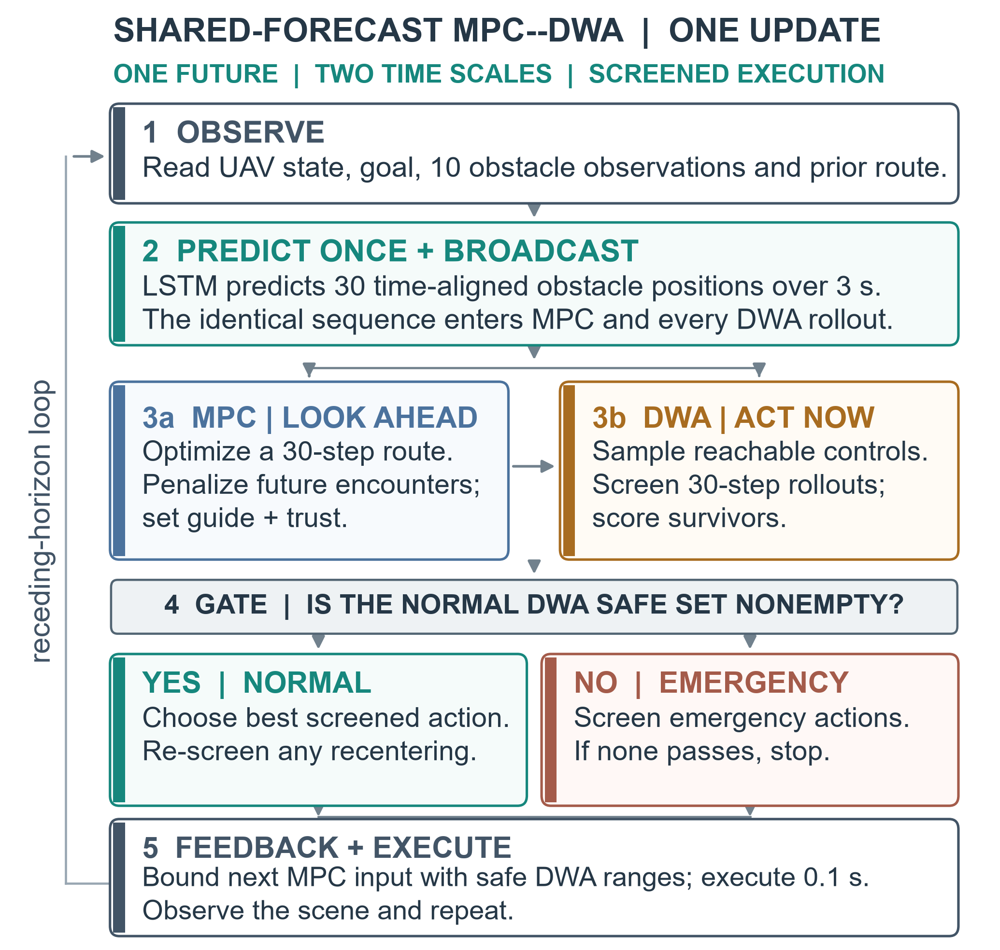
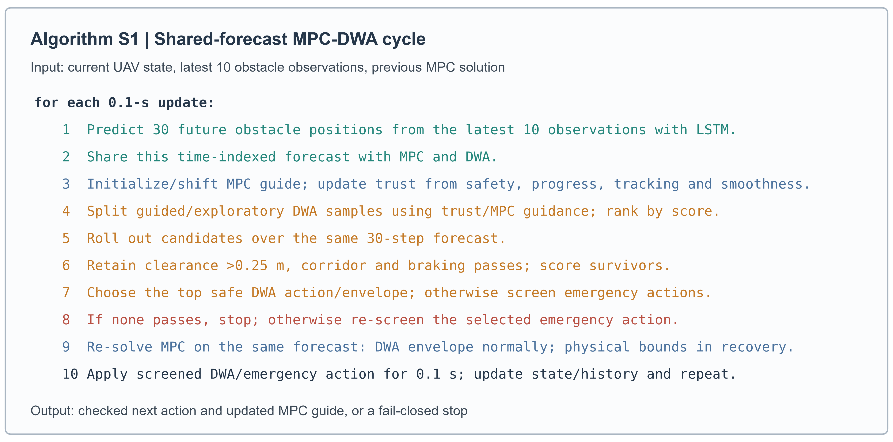
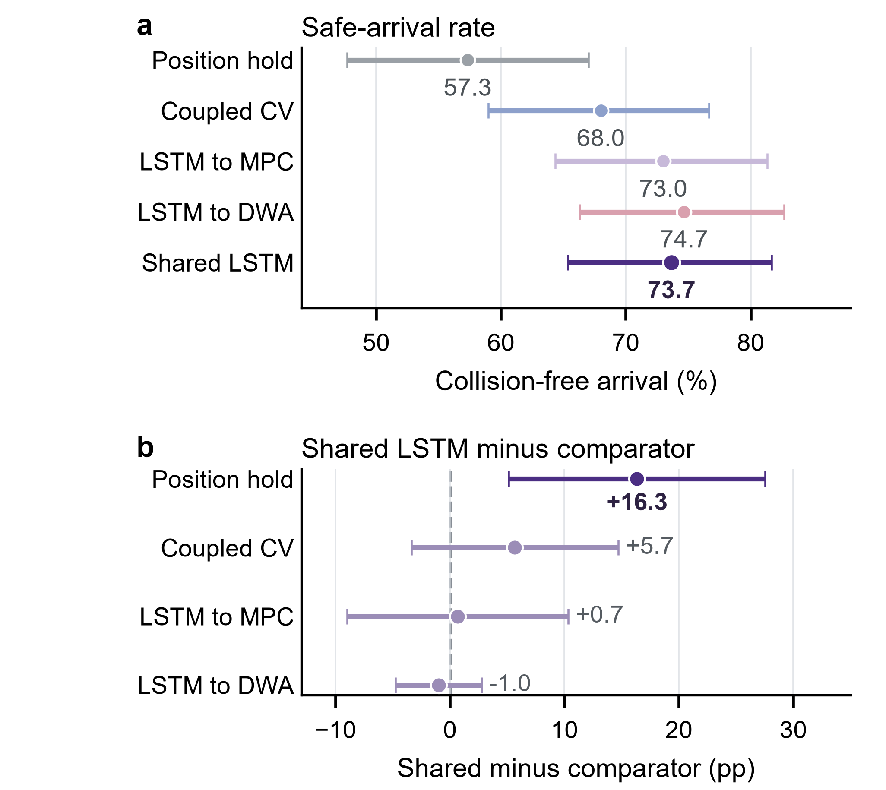
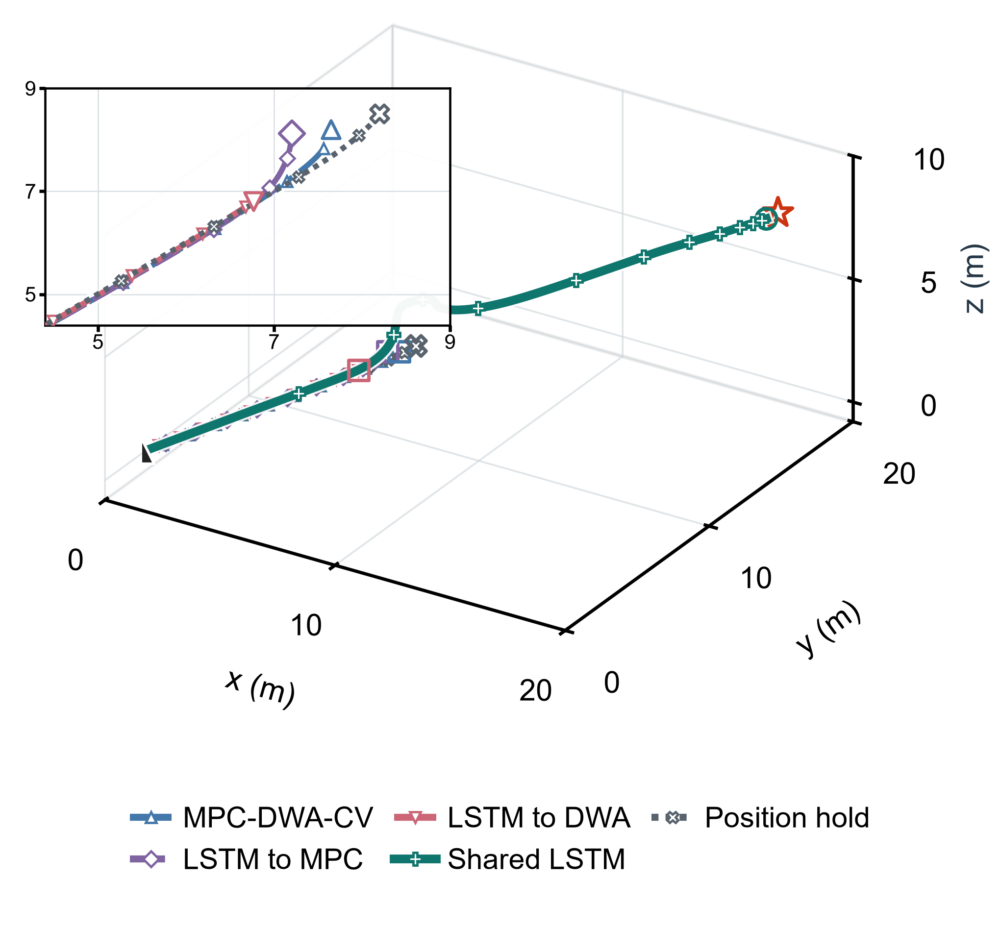
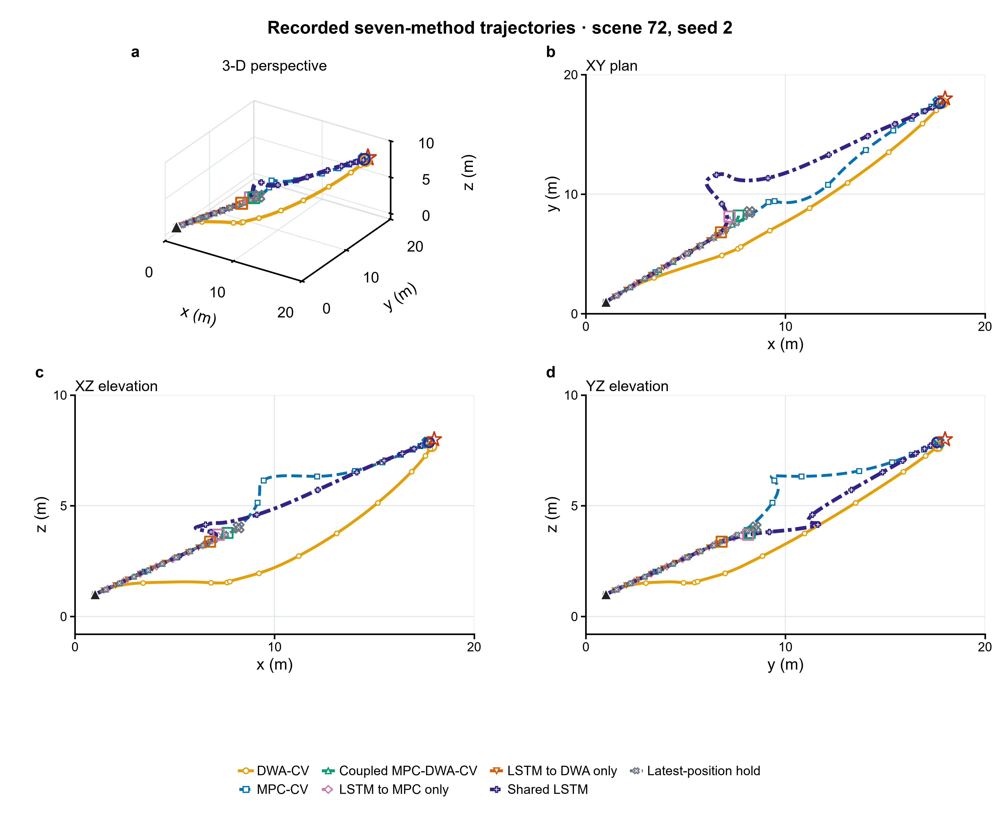

# 论文中英对照全文
**底本说明：** 本稿逐段对应当前 02_source/main.tex。主文聚焦 3 s 预测与控制时域下的五种集成 MPC–DWA 方法，共 1,500 次运行；这些记录来自完整七组、2,100 次的探索性仿真，跨架构独立控制器结果完整保留在补充表 S11–S12。4,320 次 Stage-1 记录只用于开发阶段的信任权重选择，不计入评估结果。500 场景历史基准和 CV/Kalman 对比均保留在补充材料，与当前 3 s 分析分开；本文没有真实飞行验证。

## 阅读索引

- Title, abstract, and keywords / 题名、摘要与关键词
- I. Introduction / 引言
- II. Problem Formulation / 问题建模
- III. Planning Method / 规划方法
  - Core equations / 核心公式
  - How the shared forecast is used / 共享预测的使用方式
  - Main-text pseudocode / 正文伪代码
- IV. Simulation and Results / 仿真与结果
  - Integrated 3-s comparison and matched routes / 3 s 集成方法对比与匹配路径
- V. Discussion / 讨论
- VI. Conclusion / 结论
- Supplementary Methods clarification / 补充方法说明
  - Supplementary Figure S3: retained CV/Kalman route comparison / 补充图 S3：保留的 CV/Kalman 路径对比
  - Supplementary Figure S4: historical scene 404 route example / 补充图 S4：历史场景 404 路径示例
- References / 参考文献

### 公式索引

- [E001 · Eq. (1)](#E001)：无人机运动模型与带符号表面间隙
- [E002 · Eq. (2)](#E002)：CV 与 LSTM 障碍物位置预测
- [E003 · Eq. (3)](#E003)：MPC 目标函数与耦合约束
- [E004 · Eq. (4)](#E004)：信任评分与自适应采样预算
- [E005 · Eq. (5)](#E005)：DWA 安全筛选、评分与 MPC 控制包络

## 题名与作者

**Source:** 02_source/main.tex, title and author

**Original:** Shared 3-s LSTM Forecasting for Coupled MPC--DWA UAV Planning in Dynamic Obstacle Fields
Zhenhui Fu*, Beijing University of Chemical Technology, Beijing 100029, China. *Corresponding author: 2025090094@buct.edu.cn.

**中文:** 面向动态障碍场无人机耦合 MPC–DWA 规划的共享 3 s LSTM 预测
作者：Zhenhui Fu*；北京化工大学，中国北京 100029。*通讯作者：2025090094@buct.edu.cn。

## Abstract / 摘要

**Source:** 02_source/main.tex, abstract

**Original:** First, three-dimensional UAV planning around moving obstacles is difficult because turns, acceleration and pauses make future encounter positions uncertain. Route planning and local action screening can also disagree when they use different obstacle futures. Second, we couple model predictive control (MPC) and the dynamic window approach (DWA) through one causal long short-term memory (LSTM) forecast. The LSTM predicts 3 s of obstacle motion; MPC uses it across the route horizon, while DWA tests reachable actions against the same positions and bounds MPC's first command. Third, in the five integrated arms (1,500 episodes) of a 2,100-episode matched simulation bank, shared LSTM reached without collision in 221/300 runs (73.7%) with no swept contacts. It exceeded latest-position hold by 16.3 percentage points (simultaneous 95% scene-cluster confidence interval, 5.1--27.6) and coupled constant velocity by 5.7 points (-3.4--14.7). Differences from one-layer LSTM injection were at most 1.0 point, and both intervals included zero. Finally, shared LSTM improved collision-free arrival over latest-position hold in these simulations; differences from coupled constant velocity and either one-layer LSTM variant remained uncertain. Flight validation remains future work.

**中文:** 首先，移动障碍物的转向、加速和暂停使未来相遇位置难以判断，因此三维无人机避障规划很困难；如果路线规划与局部动作筛选使用不同的障碍物未来，两层还可能给出相互矛盾的决策。其次，我们用同一条因果长短期记忆网络（LSTM）预测连接模型预测控制（MPC）和动态窗口法（DWA）。LSTM 预测未来 3 s 的障碍物运动；MPC 在整段路线时域内使用这些位置，DWA 则用相同位置检查可达动作，并约束 MPC 的首个指令。然后，在一个包含 2,100 次匹配仿真的实验库中，五种集成方法共占 1,500 次运行；共享 LSTM 在 300 次运行中有 221 次无碰撞到达（73.7%），且没有扫掠接触。它相对最新位置保持提高 16.3 个百分点（按场景聚类的同时 95% 置信区间：5.1–27.6），相对耦合恒速预测的点估计高 5.7 个百分点（−3.4–14.7）；与单层 LSTM 注入的差异不超过 1.0 个百分点，且两个区间都包含零。最后，在这些仿真中，共享 LSTM 相对最新位置保持提高了无碰撞到达率，但它与耦合恒速预测及两种单层 LSTM 方法的差异仍不确定；实机飞行仍待验证。

**Source:** 02_source/main.tex, IEEE keywords

**Original:** UAV, 3D path planning, dynamic obstacles, LSTM, model predictive control, dynamic window approach

**中文:** 无人机；三维路径规划；动态障碍物；长短期记忆网络；模型预测控制；动态窗口法。

## I. Introduction / 引言

**Source:** 02_source/main.tex, Introduction

**Original:** Unmanned aerial vehicles (UAVs) must choose safe motion before a moving obstacle reaches the same space. Recent positions are poor guides when an obstacle turns, accelerates or pauses. Model predictive control (MPC) can plan a short future route, while the dynamic window approach (DWA) can select an action that the vehicle can reach immediately [1, 2]. Forecast-based UAV planners have used predicted obstacle motion in route optimization [3, 4], but a coupled planner also needs its route and local-action layers to reason about the same future. We therefore treat forecast disagreement, rather than the absence of either planner, as the design problem. One 3-s LSTM forecast supplies both layers with a common future. MPC uses it to shape the route, DWA uses the same time-aligned positions to screen reachable actions, and the screened DWA range constrains MPC's next first command. A trust score shifts DWA sampling between the MPC guide and exploration. We compare this coupled interface with constant-velocity (CV) prediction, single-layer LSTM injection and latest-position hold.

**中文:** 无人机（UAV）必须在移动障碍物到达同一空间之前选出安全动作。障碍物转向、加速或暂停时，近期位置并不能可靠代表下一步运动。模型预测控制（MPC）可以规划一段短期未来路线，动态窗口法（DWA）则可以选择飞行器当前能够达到的动作 [1, 2]。已有预测式无人机规划器会在路线优化中使用障碍物运动预测 [3, 4]，但耦合规划器还需要让路线层和局部动作层依据同一个未来作出判断。因此，本文把“两个规划层对障碍物未来判断不一致”而非“缺少某个规划器”作为设计问题。一条 3 s LSTM 预测向两个层提供共同的未来信息。MPC 用它调整路线，DWA 用相同的时间对齐位置筛选可达动作，通过筛查的 DWA 控制范围再约束 MPC 下一次规划的首个指令。信任评分在靠近 MPC 引导路线的采样与其他方向的探索采样之间分配预算。本文将该耦合接口与恒速（CV）预测、单层 LSTM 注入和最新位置保持进行比较。

## II. Problem Formulation / 问题建模

**Source:** 02_source/main.tex, Problem Formulation

**Original:** The planning scene is a finite three-dimensional workspace with a start and a goal. The UAV and each moving obstacle are represented by spheres, and each obstacle follows a trajectory generated before the run, independently of the UAV. The planner observes the UAV's current state and the obstacles' current states and histories, but cannot access their future true positions. Figure 1 defines this geometry; recorded planner paths are shown separately. At each replanning step, the planner chooses a command containing desired speed, pitch rate and yaw rate. It predicts motion over a rolling horizon but applies only the next update's screened action before observing the scene again and replanning. The task is to reach the goal while remaining inside the flight corridor and avoiding contact with every obstacle along the trajectory. An episode ends at goal arrival, when the planner has no screened action to issue, or at the simulator's stopping limit.

**中文:** 规划场景是一个具有起点和目标点的有限三维空间。无人机与每个移动障碍物都用球体表示；障碍物轨迹在运行前生成，且不随无人机动作改变。规划器可以观测无人机当前状态以及障碍物当前状态和历史，但无法读取障碍物未来的真实位置。图 1 给出这一几何关系，规划器实际记录的路线另行展示。每次重新规划时，规划器选择一个由期望速度、俯仰角速度和偏航角速度组成的指令。它在滚动时域内预测运动，但只执行下一次更新所需且已经筛查的动作，随后重新观测场景并再次规划。任务是在保持飞行走廊约束的同时到达目标，并在整条轨迹上避免与任何障碍物接触。当无人机到达目标、没有通过筛查的动作可执行，或达到仿真停止上限时，一次运行结束。

### Figure 1 / 图 1：问题几何示意

**Original caption:** Problem geometry: the quadrotor is centered at the start and moves toward the goal among spherical obstacles following prescribed paths (arrows). The dashed line marks the direct start-to-goal direction; planner trajectories appear in Figure 4.

**中文图注：** 问题几何：四旋翼无人机以起点为中心位置，朝目标移动；球形障碍物沿预设路径运动（箭头所示）。虚线表示起点到目标的直达方向；规划器轨迹见图 4。

## III. Planning Method / 规划方法

**Source:** 02_source/main.tex, Planning Method, introductory paragraph

**Original:** The architecture follows from a specific failure mechanism: a forward route and its next local action can conflict when they assume different obstacle futures. This observation led to three design choices. First, one predictor supplies a common future to both layers. Second, MPC retains the long-horizon task of starting detours early, while DWA retains authority over the next reachable action. Third, the MPC guide and screened DWA ranges pass in opposite directions, coupling the time scales without letting the LSTM issue commands. Figure 2 follows one planning update. The LSTM converts recent obstacle states into a time-aligned 3-s sequence. At startup, MPC uses it to create an initial route; later updates shift the preceding solution forward as the new guide. The guide sets a trust score that divides DWA samples between controls near the route and controls exploring other directions. DWA rolls each sample forward for 3 s, rejects candidates that violate clearance, corridor or braking checks, and scores the survivors. The safe candidates also send information back to MPC. Their component-wise control ranges form a box that constrains only the first command of the new MPC plan; the box itself does not certify every command inside it. The new plan guides the next update, while the separately screened best DWA action is executed now. If optional lateral recentering changes that action, the modified rollout is screened again. If the normal set is empty, emergency actions pass a second safety check; the simulator stops when none passes. Thus an unchecked MPC or emergency command is never applied.

**中文:** 该架构源于一个明确的失效原因：如果前瞻路线与下一步局部动作依据不同的障碍物未来位置，两者就可能发生冲突。由此形成三个设计选择。第一，只预测一次，并把同一个未来序列交给两个规划层。第二，MPC 保留提前启动绕行的长时域任务，DWA 保留选择下一条可达动作的执行权。第三，MPC 引导与经过筛查的 DWA 控制范围沿相反方向传递，在耦合两个时间尺度的同时，不让 LSTM 直接发出控制指令。图 2 展示一次规划更新。LSTM 把近期障碍物状态转换为按时间对齐的 3 s 序列。启动时，MPC 用该序列生成初始路线；之后每次更新把上一轮解向前平移，作为新的引导路线。引导路线产生信任评分，用来在靠近路线的 DWA 控制采样与其他方向的探索采样之间分配数量。DWA 将每个样本向前滚动 3 s，剔除不满足间隙、走廊或制动条件的候选，再对剩余候选评分。安全候选还会把信息反馈给 MPC。各控制分量的取值范围组成一个控制盒，只约束新 MPC 计划的首个指令；这个控制盒本身并不保证其中每个组合都安全。新计划用于引导下一次更新，而当前真正执行的是单独筛查后得分最高的 DWA 动作。如果可选的横向重居中修改了该动作，修改后的滚动轨迹必须再次通过筛查。如果常规安全集为空，应急动作还要经过第二次安全检查；没有任何应急动作通过时，仿真停止。因此，未经检查的 MPC 或应急指令不会被执行。

### Core equations / 核心公式

**Source:** 02_source/main.tex, Core equations, introductory paragraph

**Original:** The following compact relations define the state update, obstacle forecast and quantities used by the planners.

**中文:** 下面用几组紧凑公式定义状态更新、障碍物预测及规划器使用的量。

**Source:** 02_source/main.tex, Eq. (1), eq:model

$$
\begin{aligned}
\mathbf h_t&=[\cos\theta_t\cos\psi_t,\cos\theta_t\sin\psi_t,\sin\theta_t]^{\mathsf T},\\
\mathbf p_{t+1}&=\mathbf p_t+\Delta t\,v_t\mathbf h_t,\\
v_{t+1}&=v_t+\frac{\Delta t}{\tau_v}(v_{c,t}-v_t),\\
\theta_{t+1}&=\theta_t+\Delta t\,\omega_{\theta,t},\quad
\psi_{t+1}=\psi_t+\Delta t\,\omega_{\psi,t},\\
\hat d_{j,k}&=\|\mathbf p_{t+k|t}-\hat{\mathbf o}_{j,t+k|t}\|_2-r_u-r_j.
\end{aligned}
$$

**Source:** 02_source/main.tex, paragraph after Eq. (1)

**Original:** Here $t$ is the current step, $k$ a future step, and $j=1,\ldots,M$ indexes the $M$ obstacles. The unit direction $\mathbf h_t$ follows the UAV's pitch $\theta_t$ and yaw $\psi_t$. The update period is $\Delta t=0.1$ s; $\tau_v$ is the speed-response time; $v_c,\omega_\theta,\omega_\psi$ are commanded speed, pitch rate and yaw rate. In the clearance term, $\mathbf p_{t+k|t}$ and $\hat{\mathbf o}_{j,t+k|t}$ are the predicted UAV position and obstacle centre at step $k$. The UAV and obstacle radii are $r_u$ and $r_j$. Positive $\hat d_{j,k}$ means separation, zero contact, and negative overlap.

**中文:** 这里，$t$ 表示当前步，$k$ 表示未来步，$j=1,\ldots,M$ 为 $M$ 个障碍物的索引。单位方向 $\mathbf h_t$ 由无人机俯仰角 $\theta_t$ 和偏航角 $\psi_t$ 决定。更新间隔 $\Delta t=0.1$ s；$\tau_v$ 为速度响应时间；$v_c,\omega_\theta,\omega_\psi$ 分别是速度、俯仰角速度和偏航角速度指令。在间隙计算中，$\mathbf p_{t+k|t}$ 与 $\hat{\mathbf o}_{j,t+k|t}$ 分别表示第 $k$ 步预测的无人机位置和障碍物中心。$r_u$ 和 $r_j$ 分别为无人机与障碍物半径。$\hat d_{j,k}$ 为带符号表面间隙：正值表示分离，零表示接触，负值表示重叠。

**Source:** 02_source/main.tex, paragraph introducing CV and LSTM forecasts

**Original:** At each update, the causal LSTM [5] maps ten obstacle observations to thirty 3-D offsets from the latest observed centre:

**中文:** 每次更新时，因果 LSTM [5] 将障碍物连续十次观测映射为相对于最新观测中心的 30 个三维偏移量：

**Source:** 02_source/main.tex, Eq. (2), eq:forecast

$$
\begin{aligned}
\mathbf q_{j,s}&=[\mathbf o_{j,s}^{\mathsf T},\mathbf v_{j,s}^{\mathsf T},\cos\chi_{j,s},\sin\chi_{j,s}]^{\mathsf T},\\
\hat{\mathbf o}^{\rm LSTM}_{j,t+k|t}&=\mathbf o^{\rm obs}_{j,t}+[f_{\Theta}(\mathbf q_{j,t-9:t})]_k.
\end{aligned}
$$

**Source:** 02_source/main.tex, paragraph after Eq. (2)

**Original:** Here $s$ indexes history and $k=1,\ldots,30$ indexes forecast steps. The position $\mathbf o$ and velocity $\mathbf v$ in $\mathbf q$ are observed obstacle inputs, followed by cosine and sine of heading $\chi$; thus $\mathbf q$ has eight features. The trained network $f_\Theta$ uses learned weights $\Theta$ and outputs a 3-D offset for each future step; $[\cdot]_k$ selects offset $k$. Ten observations span 0.9 s and the 30 outputs span 3 s. The forecast is causal and each offset is anchored to the latest observed centre, not cumulatively summed. At startup, the earliest state fills missing history. CV baselines extrapolate from the latest two observed positions (zero initial velocity when only one is available); position hold repeats the latest centre. Training details are in Supplementary Methods.

**中文:** 这里，$s$ 表示历史时刻索引，$k=1,\ldots,30$ 表示预测步。$\mathbf q$ 中的 $\mathbf o$ 和 $\mathbf v$ 是观测到的障碍物位置和速度，后两项是障碍物航向角 $\chi$ 的余弦与正弦，因此共有八个输入特征。$f_\Theta$ 是经过训练的网络，$\Theta$ 表示其学习得到的权重；网络为每个未来步输出一个三维偏移量，$[\cdot]_k$ 选取第 $k$ 个偏移。十次观测覆盖 0.9 s，30 个输出覆盖 3 s。预测仅依赖当前及过去信息，每个偏移均锚定在最新观测中心，而非逐步累加。启动时以最早可用状态填充历史。CV 基线根据最近两个观测位置外推（仅有一次观测时初速度置零）；位置保持基线则重复使用最新中心。训练细节见补充方法。

**Source:** 02_source/main.tex, paragraph introducing the MPC objective and coupling

**Original:** MPC uses the forecast over its 30-step horizon to minimize goal error, control effort and changes, route deviation, and obstacle-clearance penalties:

**中文:** MPC 在 30 步预测时域内使用障碍物预测，并综合最小化目标误差、控制量及其变化、路线偏离和障碍物间隙惩罚：

**Source:** 02_source/main.tex, Eq. (3), eq:mpc

$$
\begin{aligned}
\min_{\mathbf u_{1:30}}J_{\rm MPC}={}&
\sum_{k=0}^{29}w_p\|\mathbf p_{t+k|t}-\mathbf g\|_2^2\\
&+w_f\|\mathbf p_{t+30|t}-\mathbf g\|_2^2+w_rJ_r\\
&+\sum_{k=1}^{30}w_u\|\mathbf u_k\|_2^2
+w_{\Delta u}\sum_{k=2}^{30}\|\mathbf u_k-\mathbf u_{k-1}\|_2^2\\
&+\sum_{k=1}^{30}\sum_j
\left(w_o[-\hat d_{j,k}]_+^2+w_s[d_{\rm soft}-\hat d_{j,k}]_+^2\right),\\
\text{s.t. }&\mathbf x_{t+k|t}=f(\mathbf x_{t+k-1|t},\mathbf u_k),\quad
\mathbf u_1\in\mathcal U_t\ \text{if }\mathcal A_t\ne\varnothing.
\end{aligned}
$$

**Source:** 02_source/main.tex, paragraph after Eq. (3)

**Original:** Here $\mathbf u_{1:30}$ denotes the sequence of 30 future commands; $\mathbf x=[\mathbf p^{\mathsf T},\theta,\psi,v]^{\mathsf T}$ is the position--pitch--yaw--speed state; $\mathbf u_k=[v_{c,k},\omega_{\theta,k},\omega_{\psi,k}]^{\mathsf T}$ is command $k$, $\mathbf g$ is the goal, and $f$ is the discrete state transition in Eq. (1). $J_r$ sums squared cross-track distances from the direct start-to-goal line. The weights $w_p,w_f,w_r,w_u,w_{\Delta u},w_o,w_s$ penalize stage goal error, terminal error, route deviation, control effort, command changes, overlap and clearance below $d_{\rm soft}=0.35$ m. The positive-part function is $[x]_+=\max(0,x)$. Physical command and rate limits remain active; because native command values are squared without cross-channel normalization, the effort term is heuristic rather than physical energy. Full geometric definitions, weights and limits are in Supplementary Methods S1.1. Clearance penalties are soft and do not certify safety.

**中文:** 这里，$\mathbf u_{1:30}$ 表示未来 30 步控制指令组成的序列；$\mathbf x=[\mathbf p^{\mathsf T},\theta,\psi,v]^{\mathsf T}$ 表示位置、俯仰角、偏航角和速度状态；$\mathbf u_k=[v_{c,k},\omega_{\theta,k},\omega_{\psi,k}]^{\mathsf T}$ 是第 $k$ 步控制指令，$\mathbf g$ 是目标点，$f$ 表示式（1）中的离散状态转移函数。$J_r$ 汇总预测路线相对起点—目标直线的平方横向距离。权重 $w_p,w_f,w_r,w_u,w_{\Delta u},w_o,w_s$ 依次惩罚阶段目标误差、终端误差、路线偏差、控制量、控制变化、障碍物重叠，以及小于 $d_{\rm soft}=0.35$ m 的间隙。正部函数为 $[x]_+=\max(0,x)$。物理控制量与变化率限值始终生效；实现中不同单位的控制量直接平方且未作通道归一化，因此控制代价是启发式量，而非物理能量。几何定义、权重和限值见补充方法 S1.1。间隙项是软惩罚，本身不构成安全保证。

**Source:** 02_source/main.tex, trust-score introduction

**Original:** Trust allocates DWA samples between guided and exploratory actions using safety, goal progress, agreement with the previous MPC guide, and control smoothness:

**中文:** 信任评分依据预测安全性、目标推进、与上一轮 MPC 引导路线的一致程度和控制平滑性，在 DWA 引导采样与探索采样之间分配计算资源：

**Source:** 02_source/main.tex, Eq. (4), eq:trust

$$
\begin{aligned}
\tau&=\sigma_s\tau_{\rm sa}+\sigma_g\tau_g+\sigma_t\tau_{\rm ref}+\sigma_m\tau_{\rm sm},\\
\tau_{\rm ref}&=\exp(-\alpha_T\Delta_p),\\
B&=\operatorname{round}[300(1+\alpha e^{-\beta\tau})],\\
B_g&=\operatorname{round}(B\tau),\quad B_e=B-B_g.
\end{aligned}
$$

**Source:** 02_source/main.tex, paragraph after Eq. (4)

**Original:** The four trust components describe the current MPC guide. Safety is its minimum predicted clearance. Goal progress is the decrease in goal distance from the guide's first to last point. Reference match falls with the distance $\Delta_p$ between the UAV and the guide's first point, and smoothness measures changes between planned controls. All four terms are normalized to $[0,1]$. The coefficients $\sigma_s,\sigma_g,\sigma_t,\sigma_m$ weight safety, progress, reference match and smoothness, respectively, and sum to one. The decay $\alpha_T$ sets how quickly reference match falls with distance; $\alpha$ and $\beta$ set the size and trust sensitivity of the sampling budget. Here $B_g$ and $B_e$ are the guided and exploratory candidate counts. Higher trust sends more samples toward the MPC guide while reducing the total count. Six coefficient vectors were tested across five integrated arms, 48 development scenes and three seeds ($6\times5\times48\times3=4,320$ episodes). The selected vector $[0.15,0.15,0.15,0.55]$ produced the highest equal-arm mean safe-arrival rate, 0.8042, and was fixed before the 100-scene evaluation. Full component definitions are in Supplementary Methods S1.2.

**中文:** 四个信任分量描述当前 MPC 引导路线。安全分量取其最小预测间隙；目标推进分量衡量引导路线首末两点到目标距离的减少；参考匹配分量随无人机当前位置与引导路线第一点的距离 $\Delta_p$ 增大而下降；平滑分量衡量规划控制的变化。四项都归一化到 $[0,1]$。系数 $\sigma_s,\sigma_g,\sigma_t,\sigma_m$ 依次为安全、推进、参考匹配和平滑分量赋权，且总和为 1。$\alpha_T$ 决定参考匹配随距离衰减的速度，$\alpha$ 与 $\beta$ 决定采样预算的大小及其对信任度的敏感程度；$B_g$ 和 $B_e$ 分别表示引导候选和探索候选的数量。信任度越高，越多样本靠近 MPC 引导路线，同时总样本数减少。开发阶段在五种集成分支、48 个场景和每场景三个种子上测试六个候选向量，共 $6\times5\times48\times3=4,320$ 次仿真。向量 $[0.15,0.15,0.15,0.55]$ 的五分支等权平均安全到达率最高，为 0.8042，因此在 100 场景评估前固定。完整分量定义见补充方法 S1.2。

**Source:** 02_source/main.tex, DWA screening and scoring introduction

**Original:** DWA rejects unsafe rollouts, scores the survivors, and uses their control range to bound MPC's first input:

**中文:** DWA 首先剔除不安全的滚动轨迹，再对保留动作评分，并用其控制范围约束 MPC 的首个输入：

**Source:** 02_source/main.tex, Eq. (5), eq:dwa

$$
\begin{aligned}
\mathcal A_t&=\{b\in\mathcal B_t:d_{\min}^{(b)}>0.25~\mathrm m,\ \mathcal C_b=1,\\
&\hspace{1em}(v_{\rm end}^{(b)})^2\leq2a_{\max}d_{\min}^{(b)}\},\quad
b^*=\arg\max_{b\in\mathcal A_t}S_b,\quad \mathcal A_t\ne\varnothing,\\
u_{i,t}^{-}&=\max\!\left(u_i^{\min},\min_{b\in\mathcal A_t}u_i^{(b)}-\delta\right),\\
u_{i,t}^{+}&=\min\!\left(u_i^{\max},\max_{b\in\mathcal A_t}u_i^{(b)}+\delta\right),\\
\mathcal U_t&=\prod_{i=1}^{3}[u_{i,t}^{-},u_{i,t}^{+}],\quad \delta=0.1.
\end{aligned}
$$

**Source:** 02_source/main.tex, paragraph after Eq. (5)

**Original:** Here $b$ indexes a candidate, $\mathcal B_t$ is the sampled set, and $\mathcal A_t$ contains candidates passing all three gates. The minimum surface clearance $d_{\min}^{(b)}$ is checked at all 30 time-aligned rollout states against the shared forecast and must exceed 0.25 m. The indicator $\mathcal C_b=1$ means the whole rollout stays inside the altitude limits and route corridor. Its terminal speed is $v_{\rm end}^{(b)}$, and $a_{\max}=1.0$ m s$^{-2}$ is the available braking deceleration. The score $S_b$ favors agreement with the MPC guide, obstacle clearance and a suitable vertical profile. For a nonempty safe set, $i$ denotes desired speed, pitch rate or yaw rate. The interval in each channel expands the observed safe range by $\delta=0.1$ in that channel's native units, then clips it to the physical limits $u_i^{\min}$ and $u_i^{\max}$. Their product $\mathcal U_t$ constrains MPC's first input. A continuous piecewise-linear audit checks between saved simulator states when outcomes are classified. Full scores and fallback rules are in Supplementary Methods S1.2--S1.4.

**中文:** 这里，$b$ 表示一个候选动作，$\mathcal B_t$ 是采样集合，$\mathcal A_t$ 包含通过三项检查的候选。候选 $b$ 的最小表面间隙 $d_{\min}^{(b)}$ 要在全部 30 个时间对齐的滚动状态上与共享预测比较，并且必须大于 0.25 m。$\mathcal C_b=1$ 表示整条滚动轨迹都处于高度限制和路线走廊内。$v_{\rm end}^{(b)}$ 是末端速度，$a_{\max}=1.0$ m s$^{-2}$ 是可用制动减速度。评分 $S_b$ 偏好与 MPC 引导一致、障碍间隙较大且垂直剖面合适的动作。安全集非空时，$i$ 依次表示期望速度、俯仰角速度或偏航角速度。每个通道的区间在该通道原生单位下将观测到的安全范围扩展 $\delta=0.1$，再裁剪到物理上下限 $u_i^{\min}$ 和 $u_i^{\max}$。三段区间的乘积 $\mathcal U_t$ 约束 MPC 的首个输入。结果分类时，连续分段线性审计还会检查相邻仿真保存状态之间的扫掠路径。完整评分与回退规则见补充方法 S1.2–S1.4。

### How the shared forecast is used / 共享预测的使用方式

**Source:** 02_source/main.tex, How the shared forecast is used

**Original:** The LSTM does not command the UAV. It supplies future obstacle centres on the same time grid to two different decisions. MPC uses all 30 positions in its clearance costs, so the route can bend before a future encounter. DWA compares each reachable rollout with those same positions, so the next action is checked against the future assumed by MPC. The preceding MPC guide also changes DWA's guided/exploratory sample mix, while the accepted DWA range limits MPC's next first command. This shared input plus two-way feedback is the central design change. Supplementary Methods S1.4 gives the complete execution order.

**中文:** LSTM 不直接向无人机发指令，而是在同一时间网格上把未来障碍物中心提供给两种不同决策。MPC 在间隙代价中使用全部 30 个位置，使路线能够在未来相遇之前提前弯折；DWA 用相同位置检查每条可达滚动轨迹，使下一动作针对 MPC 所假设的同一未来完成筛查。上一轮 MPC 引导还会改变 DWA 引导采样与探索采样的分配，而 DWA 接受的控制范围会限制 MPC 下一次规划的首个指令。共享输入和这种双向反馈是本文方法的核心改动。完整执行顺序见补充方法 S1.4。

### Figure 2 / 图 2：共享预测规划器伪代码

**Original caption:** Five modules in one 0.1-s update. One 3-s LSTM forecast feeds both the long-horizon MPC route and the reachable-action DWA screen. The MPC guide shapes DWA sampling, while screened DWA ranges bound MPC's next first command. Normal, recentered and emergency actions are screened before execution.

**中文图注：** 一次 0.1 s 更新中的五个模块。同一条 3 s LSTM 预测同时进入长时域 MPC 路线规划和可达动作 DWA 筛查。MPC 引导改变 DWA 的采样分配，经过筛查的 DWA 控制范围则约束 MPC 下一次规划的首个指令。普通、重居中和应急动作都必须先通过筛查再执行。

#### Algorithm S1 / 算法 S1：共享预测的 MPC–DWA 循环

**中文步骤说明：** 输入为无人机当前状态、障碍物最近 10 次观测和上一轮 MPC 解。每个 0.1 s 周期中，LSTM 根据观测预测未来 30 步障碍物位置，并将同一条带时间索引的预测交给 MPC 与 DWA；MPC 在启动时初始化参考路线，之后滚动上一轮解。随后根据安全、目标进展、路线跟踪和控制平滑度更新信任度，并据此调整 DWA 引导采样与探索采样的分配。DWA 对可达控制动作展开轨迹，在相同的 30 步预测上依次检查间隙、飞行走廊和制动条件，再对保留动作评分。若常规安全候选存在，则选出 DWA 动作及其控制范围；否则筛查紧急动作。若紧急候选为空则停止；有候选时，在重求解前再次筛查选定的紧急动作。随后 MPC 使用同一预测重求解：常规情况下受 DWA 安全动作范围约束，回退情况下仅受物理控制限值约束。最后执行通过检查的 DWA/紧急动作 0.1 s，更新状态和历史并进入下一轮。输出为通过检查的下一动作及更新后的 MPC 参考，或安全停止。

## IV. Simulation and Results / 仿真与结果

**Source:** 02_source/main.tex, Simulation and Results, design paragraph

**Original:** The complete exploratory bank contains 2,100 episodes over seven arms. Here we focus on the five integrated MPC--DWA arms, giving 1,500 episodes, while retaining the original six-contrast simultaneous correction; the two standalone arms remain in Supplementary Tables S11--S12. Each arm used 0.1-s updates, 3-s MPC and DWA horizons, 100 scenes, and three matched seeds per scene. In the one-layer LSTM variants, the other layer used CV extrapolation; coupled CV and position hold supplied their respective predictions to both layers. A safe arrival required goal tolerance with no swept-path contact. Seeds were averaged within scene, and 20,000 scene-cluster bootstrap resamples formed simultaneous intervals for shared-minus-comparator differences.

**中文:** 完整探索性实验库包含七种方法、共 2,100 次运行。正文聚焦五种集成 MPC–DWA 方法，共 1,500 次，但仍保留原先六项对比的同时校正；两种独立方法的结果见补充表 S11–S12。每种方法都采用 0.1 s 更新、3 s MPC 与 DWA 时域、100 个场景以及每场景三个匹配种子。单层 LSTM 方法中，未接收 LSTM 的另一层使用 CV 外推；耦合 CV 与位置保持方法则分别向两个层提供各自的预测。安全到达要求进入目标容差且扫掠路径无接触。分析先在场景内平均三个种子，再用 20,000 次按场景聚类的 bootstrap 重采样构造共享方法相对各比较方法的同时区间。

**Source:** 02_source/main.tex, Simulation and Results, outcome paragraph

**Original:** Shared LSTM reached safely in 221/300 runs (73.7%). Latest-position hold reached 172/300 (57.3%), giving a shared-forecast gain of 16.3 percentage points (95% CI, 5.1--27.6). Coupled CV reached 204/300 (68.0%); the corresponding point estimate was 5.7 points higher (-3.4--14.7). LSTM supplied only to MPC reached 219/300 (73.0%), and LSTM supplied only to DWA reached 224/300 (74.7%). Their differences from sharing were +0.7 points (-9.0--10.3) and -1.0 point (-4.8--2.8), respectively. Shared LSTM therefore improved collision-free arrival over position hold; the intervals did not establish an advantage over coupled CV or either one-layer LSTM variant (Figure 3).

**中文:** 共享 LSTM 在 300 次运行中有 221 次安全到达（73.7%）。最新位置保持为 172/300（57.3%），因此共享预测高 16.3 个百分点（95% CI：5.1–27.6）。耦合 CV 为 204/300（68.0%），共享方法的点估计高 5.7 个百分点（−3.4–14.7）。仅 MPC 使用 LSTM 为 219/300（73.0%），仅 DWA 使用 LSTM 为 224/300（74.7%）；它们相对共享方法的差异分别为 +0.7 个百分点（−9.0–10.3）和 −1.0 个百分点（−4.8–2.8）。因此，共享 LSTM 相对位置保持提高了无碰撞到达率；现有区间不能证明它优于耦合 CV 或任一单层 LSTM 方法（图 3）。

### Figure 3 / 图 3：3 s 集成控制器结果

**Original caption:** Integrated-controller results with a 3-s MPC and DWA horizon. (a) Collision-free arrival rate with scene-bootstrap percentile 95% CIs ($n=300$ per method; 100 scenes and three matched seeds). (b) Four displayed shared-LSTM minus comparator differences with simultaneous max-$|t|$ 95% scene-cluster CIs; positive values favor sharing, and multiplicity control covers all six original contrasts. Position hold recorded 50 swept-contact episodes, while the other four methods recorded none. Cross-family standalone results are reported in Supplementary Tables S11--S12.

**中文图注：** 3 s MPC 与 DWA 时域下的集成控制器结果。(a) 无碰撞到达率及按场景 bootstrap 得到的百分位 95% CI（每种方法 $n=300$；100 个场景，每场景三个匹配种子）。(b) 图中展示四项共享 LSTM 减去比较方法的差值及按场景聚类的同时 max-$|t|$ 95% CI；正值有利于共享方法，同时校正覆盖原先全部六项对比。位置保持有 50 次扫掠接触，其他四种集成方法均为 0。跨架构的独立方法结果见补充表 S11–S12。

**Source:** 02_source/main.tex, illustrative integrated-route paragraph

**Original:** Figure 4 shows one matched case selected post hoc for outcome and route visibility. Only shared LSTM reached safely among the five integrated methods. The inset redraws the four comparator paths without the shared path so their overlapping terminal geometry remains visible; no coordinates are moved.

**中文:** 图 4 展示一个为结果与路线可见性而事后选择的匹配示例。在五种集成方法中，只有共享 LSTM 安全到达。插图不绘制共享方法，只重绘四条比较方法的真实记录点，从而显示它们相互重叠的末段几何形状；所有坐标保持不变。

### Figure 4 / 图 4：五种集成方法的匹配路线示例

**Original caption:** Five integrated paths in one matched case (scene 72, seed 2). The main view contains all five paths; the XY inset magnifies the logged terminal segments of the four comparators only. The black triangle and red star mark the start and goal. Only shared LSTM reached safely; coupled CV and the two one-layer LSTM variants stopped without contact, while position hold had a swept contact. Every line stops at its recorded endpoint. The circle, squares and cross mark safe arrival, other non-arrival and a contact episode; the cross reports the outcome, not the contact location.

**中文图注：** 场景 72、种子 2 中五种集成方法的匹配路线。主视图包含全部五条路线；XY 插图只放大四条比较方法在日志中记录的末段。黑色三角形和红色星形分别标出起点与目标。只有共享 LSTM 安全到达；耦合 CV 与两种单层 LSTM 方法均无接触停止，位置保持则发生扫掠接触。每条线截止于真实记录终点。圆形、方形和叉号分别表示安全到达、其他未到达和发生过接触的运行；叉号只报告运行结果，不表示接触位置。

### Supplementary Table S11 / 补充表 S11：七方法探索性结果

**Original caption:** Outcome summary for the exploratory simulation (300 episodes per arm). Safe arrival requires reaching the goal without swept-path contact; complete paired intervals are reported in the Supplementary Methods.

**中文表注：** 探索性仿真结果汇总，每种方法 300 次运行。安全到达要求进入目标容差且扫掠路径无接触；完整配对区间见补充方法。

| Controller / 控制器 | Safe-goal rate (%) / 安全到达率（%） | Swept contacts / 扫掠接触 |
|---|---:|---:|
| Standalone DWA-CV / 独立 DWA-CV | 78.0 | 0 |
| Standalone MPC-CV / 独立 MPC-CV | 92.0 | 15 |
| Coupled MPC–DWA-CV / 耦合 MPC–DWA-CV | 68.0 | 0 |
| MPC–DWA (LSTM to MPC only) / MPC–DWA（仅 MPC 使用 LSTM） | 73.0 | 0 |
| MPC–DWA (LSTM to DWA only) / MPC–DWA（仅 DWA 使用 LSTM） | 74.7 | 0 |
| MPC–DWA (shared LSTM) / MPC–DWA（共享 LSTM） | **73.7** | **0** |
| MPC–DWA (latest-position hold) / MPC–DWA（最新位置保持） | 57.3 | 50 |

### Historical five-controller comparison / 历史五控制器对比

**Source:** 03_supplementary/supplementary_methods.tex, S4.2–S4.3

**Original:** The historical five-controller study used 500 scenes with three matched seeds per scene (1,500 episodes per arm), a 1-s DWA rollout and a 30-step MPC horizon. Shared LSTM reached the goal without contact in 936/1,500 episodes (62.4%), compared with 33/1,500 (2.2%) for latest-position hold and 836/1,500 (55.7%) for LSTM-to-DWA-only integration. The paired differences were +60.2 percentage points (95% scene-cluster CI, +56.2 to +64.2) and +6.7 points (+4.2 to +9.2), respectively. Standalone DWA+LSTM and MPC+LSTM reached in 1,236/1,500 (82.4%) and 1,428/1,500 (95.2%). Shared integration was lower than these arms by 20.0 points (95% CI, -24.8 to -15.1) and 32.8 points (-37.1 to -28.5). This historical 1-s study is separate from the current seven-method, 3-s-horizon evaluation.

**中文:** 历史五控制器研究在 500 个场景、每场景三个匹配种子上进行测试（每种方法 1,500 次），DWA 滚动时域为 1 s，MPC 时域为 30 步。共享 LSTM 在 1,500 次运行中有 936 次无接触到达目标（62.4%）；最新位置保持组为 33/1,500 次（2.2%），仅向 DWA 输入 LSTM 的集成组为 836/1,500 次（55.7%）。相应配对差异为 +60.2 个百分点（按场景聚类的 95% CI：+56.2 至 +64.2）和 +6.7 个百分点（+4.2 至 +9.2）。独立 DWA+LSTM 和 MPC+LSTM 分别有 1,236/1,500 次（82.4%）和 1,428/1,500 次（95.2%）到达。共享集成方法分别低 20.0 个百分点（95% CI：−24.8 至 −15.1）和 32.8 个百分点（−37.1 至 −28.5）。这项历史 1 s 研究与当前七方法、3 s 时域评估相互独立。

### Supplementary Table S6 / 补充表 S6：历史五控制器研究结果

**Original caption:** Retained results from the historical five-controller study (500 scenes, three matched seeds and 1,500 runs per method; 1-s DWA screening). The latest-position-hold MPC--DWA is a project-local architectural comparator, not a direct rerun.

**中文表注：** 保留的历史五控制器研究结果（500 个场景、每场景三个匹配种子，每种方法 1,500 次；DWA 筛查时域为 1 s）。最新位置保持 MPC–DWA 是项目内构建的架构对照，不是对某项实现的直接复跑。

| Controller / 控制器 | Goal without collision / 无碰撞到达目标 | Swept collision runs / 扫掠碰撞运行次数 |
|---|---:|---:|
| MPC–DWA reconstruction (position hold) / MPC–DWA 重构（位置保持） | 33/1,500 (2.2%) | 624 (41.6%) |
| Integrated MPC–DWA (LSTM to DWA only) / 集成 MPC–DWA（仅 DWA 使用 LSTM） | 836/1,500 (55.7%) | 2 (0.13%) |
| Integrated MPC–DWA (shared LSTM) / 集成 MPC–DWA（共享 LSTM） | **936/1,500 (62.4%)** | **0 (0%)** |
| Standalone DWA + LSTM / 独立 DWA + LSTM | 1,236/1,500 (82.4%) | 0 (0%) |
| Standalone MPC + LSTM / 独立 MPC + LSTM | 1,428/1,500 (95.2%) | 36 (2.4%) |

## V. Discussion / 讨论

**Source:** 02_source/main.tex, Discussion, paragraph 1

**Original:** The architecture aligns information without collapsing the two control roles. MPC anticipates a conflict and bends the route, while DWA checks what the UAV can reach immediately. Sharing the 3-s obstacle sequence removes forecast disagreement between these decisions. Returning screened control ranges lets local feasibility shape MPC's next first command, while the separately screened DWA action remains the command executed. The interface can therefore be inspected at the forecast, route, candidate and execution stages. The component-wise box narrows the MPC search; it does not certify every command inside it.

The outcome pattern is consistent with this design. Position hold supplies no obstacle motion, so both layers can act on a rapidly outdated picture; sharing the forecast removes that limitation and improved collision-free arrival. Coupled CV already represents motion, and each one-layer LSTM variant still gives one planning layer a learned forecast, so the remaining point differences were smaller. In the tested scenes, their intervals did not establish an additional arrival benefit from supplying LSTM forecasts to both layers. The method was evaluated with prescribed obstacle tracks, point forecasts and simulator-recorded motion features. Prediction uncertainty, unseen motion families and real flight remain the next validation steps.

**中文:** 该架构对齐两个层使用的信息，同时保留它们不同的控制职责。MPC 提前判断冲突并调整路线，DWA 则检查无人机当前能够到达的动作。共享同一条 3 s 障碍物序列，消除了两种决策之间的未来判断分歧。把经过筛查的控制范围反馈给 MPC，使局部可行性影响其下一次规划的首个指令，而当前实际执行的仍是单独通过检查的 DWA 动作。因此，从预测、路线、候选动作到最终执行，每一级都可以单独检查。分量级控制盒只缩小 MPC 的搜索范围，并不保证盒内每个指令都安全。

结果模式与这一设计相符。位置保持不描述障碍物运动，使两层都可能依据迅速过时的场景作出决策；共享预测消除了这一缺陷，并提高了无碰撞到达率。耦合 CV 已能表示运动，而每种单层 LSTM 方案也让其中一个规划层获得了学习预测，因此其余点估计差异较小。在测试场景中，相应区间未能证明同时向两层提供 LSTM 会产生额外到达收益。本方法在预设障碍物轨迹、点预测和仿真器记录的运动特征下完成评估；下一步需要检验预测不确定性、未见过的运动类型以及真实飞行表现。

## VI. Conclusion / 结论

**Source:** 02_source/main.tex, Conclusion

**Original:** The planner shares one 3-s LSTM forecast with MPC and DWA, then feeds DWA's screened control range back to MPC. In simulation it achieved 73.7% collision-free arrival, 16.3 percentage points above position hold. Differences from coupled CV and one-layer LSTM injection remained uncertain; flight performance remains to be measured.

**中文:** 本文规划器让 MPC 与 DWA 共享同一条 3 s LSTM 预测，并把 DWA 筛选后的控制范围反馈给 MPC。其仿真无碰撞到达率为 73.7%，比位置保持高 16.3 个百分点。它与耦合 CV 和单层 LSTM 注入之间的差异仍不确定，真实飞行性能仍需测量。

## Supplementary Methods clarification / 补充方法说明

**Source:** ../03_supplementary/supplementary_methods.tex, S1.2–S1.3

**Original:** Smoothness uses consecutive MPC control increments $\Delta\mathbf u_k=\mathbf u_k-\mathbf u_{k-1}$. The score is $\tau_{\rm sm}=\operatorname{clip}_{[0,1]}\!\left[1-\frac{1}{3(N-1)}\sum_{i=1}^{3}\sum_{k=2}^{N}\frac{|\Delta u_{k,i}|}{a_{u,i}\Delta t}\right]$.

Here $i$ indexes desired speed, pitch rate and yaw rate; $N=30$, $\Delta t=0.1$ s, and $\mathbf a_u=[1~\mathrm{m\,s^{-2}},\ 0.5~\mathrm{rad\,s^{-2}},\ 0.5~\mathrm{rad\,s^{-2}}]^{\mathsf T}$. At startup, the initial MPC solution initializes the aligned reference and control sequence; thereafter, the preceding solution is shifted before the trust scores are computed. Guided controls are sampled within $r_{\rm Guide}=0.35$ per control component of the clipped MPC command, then clipped to the dynamic window. The logistic map is $q=[1+\exp(-8(\tau-0.5))]^{-1}$. The half-width 0.35, slope 8, midpoint 0.5 and additive vertical-score coefficient $w_z=0.25$ are fixed implementation heuristics, held constant in every integrated arm that uses them and not selected using held-out outcomes. The half-width uses native control units ($\mathrm{m\,s^{-1}}$ for speed and $\mathrm{rad\,s^{-1}}$ for pitch and yaw rates); slope and midpoint are dimensionless. The $w_z$ term is added after the four normalized DWA weights and is not renormalized with them.

**中文:** 平滑度分量使用相邻 MPC 控制量的增量 $\Delta\mathbf u_k=\mathbf u_k-\mathbf u_{k-1}$。其评分定义为 $\tau_{\rm sm}=\operatorname{clip}_{[0,1]}\!\left[1-\frac{1}{3(N-1)}\sum_{i=1}^{3}\sum_{k=2}^{N}\frac{|\Delta u_{k,i}|}{a_{u,i}\Delta t}\right]$。其中，$i$ 依次表示期望速度、俯仰角速度和偏航角速度；$N=30$，$\Delta t=0.1$ s，且 $\mathbf a_u=[1~\mathrm{m\,s^{-2}},\ 0.5~\mathrm{rad\,s^{-2}},\ 0.5~\mathrm{rad\,s^{-2}}]^{\mathsf T}$。启动时，以初始 MPC 解初始化对齐后的参考路线与控制序列；此后在计算信任评分前，对上一周期解进行时移。引导控制在裁剪后的 MPC 指令周围按每个控制分量的 $r_{\rm Guide}=0.35$ 半宽采样，随后裁剪到动态窗口内。逻辑映射为 $q=[1+\exp(-8(\tau-0.5))]^{-1}$。半宽 0.35、斜率 8、中点 0.5 和附加垂直评分系数 $w_z=0.25$ 均为固定实现启发式参数；所有使用这些参数的集成分支均保持不变，且未依据留出结果选择。半宽采用各控制量的原生单位（速度为 $\mathrm{m\,s^{-1}}$，俯仰和偏航角速度为 $\mathrm{rad\,s^{-1}}$）；斜率和中点无量纲。$w_z$ 项在四个归一化 DWA 权重之后加入，且不与它们一起重新归一化。

**Source:** ../scripts/run_v12a_pooled_weight_development.m:123,164; ../04_review/v12a_stage1_recovery_audit_20261014.md:5,9,13

**Original:** The Stage-1 trust-weight calibration evaluated six candidate vectors across five trust-using integrated MPC--DWA branches, 48 development scenes and three matched seeds ($6\times5\times48\times3=4{,}320$ simulation episodes). The selected vector $[0.15,0.15,0.15,0.55]$ had an equal-arm macro-average collision-free arrival rate of 0.8042. Development rates were 0.8958 for shared LSTM, 0.7431 for CV-coupled MPC--DWA, 0.8194 for LSTM-to-MPC-only, 0.8958 for LSTM-to-DWA-only and 0.6667 for latest-position hold. These are selection-set descriptions, not held-out comparisons. The earlier 864-episode six-setting comparison used a different protocol and was not reused; a separate recovery audit validated all 4,320 Stage-1 episode records without creating new simulations.

**中文:** 阶段 1 信任权重校准在五种使用信任评分的集成 MPC--DWA 分支、48 个开发场景和每场景 3 个匹配种子上评估六个候选向量（$6\times5\times48\times3=4{,}320$ 次仿真）。选出的向量为 $[0.15,0.15,0.15,0.55]$，其五分支等权宏平均无碰撞到达率为 0.8042。开发率分别为：共享 LSTM 0.8958、CV 耦合 MPC--DWA 0.7431、仅 MPC 使用 LSTM 0.8194、仅 DWA 使用 LSTM 0.8958、最新位置保持 0.6667。这些是用于选参的开发集描述值，不是留出对比结果。此前 864 次六设置实验采用不同协议，未用于本次选择；单独的恢复审计对全部 4,320 条记录进行了校验，没有新增仿真。

### Historical route illustrations / 历史路径示例

### Supplementary Figure S3 / 补图 S3：保留的 CV/Kalman 历史路径

**Source:** 03_supplementary/supplementary_methods.tex, Fig. historical-scene2

**Original caption:** Historical four-method 3-D route example from scene 2 and DWA sampling seed 1. Panels (a)--(d) show CV, Kalman, DWA-only LSTM and shared LSTM under the same prescribed obstacle tracks. The green triangle marks the start, the red star the goal, and the open circle CV's recorded early-stop endpoint. In this example, CV stopped before the goal; the other three methods reached the goal, and all four routes were collision-free under the swept-path test. Each route contains only its saved states through the recorded terminal point; none is extended or interpolated. Obstacle tracks show scene context and are not time-aligned with route durations. This single historical example illustrates route geometry, not aggregate performance, and is reported separately from the historical five-controller benchmark and current seven-method evaluation.

**中文图注：** 历史四方法三维路径示例，取自场景 2、DWA 采样种子 1。(a)–(d) 分别为 CV、Kalman、仅 DWA 使用 LSTM 和共享 LSTM，使用相同的预设障碍物轨迹。绿色三角表示起点，红色星形表示目标点，空心圆表示 CV 记录的提前停止位置。在该例中，CV 未到达目标；其余三种方法到达目标，且四条轨迹均未发生扫掠碰撞。每条路线仅包含已记录状态，并截止于实际终止点，不外延或插值。障碍物轨迹仅作为场景背景，未与各方法的飞行时长进行时间对齐。该单个历史示例展示路径形状，不代表总体性能；其结果与历史五控制器基准及当前七方法评估分开报告。

### Supplementary Figure S4 / 补图 S4：历史场景 404 路径

**Source:** 03_supplementary/supplementary_methods.tex, S7, Fig. primaryroutes

**Original caption:** Historical five-controller 3-D routes from scene 404, seed 2 in the 1-s DWA-screening study. The recorded paths end at their logged terminal states: latest-position-hold MPC--DWA (collision, step 224); standalone DWA + LSTM (stopped, step 20); standalone MPC + LSTM (collision, step 262); integrated MPC--DWA with LSTM to DWA only (stopped, step 220); and integrated MPC--DWA with shared LSTM (collision-free arrival, step 253). Only the shared controller arrived in this illustrative case; aggregate historical outcomes are in Table S6 and Supplementary Methods S4.3. Dashed lines show saved obstacle tracks through step 262. Circles mark arrivals, squares mark non-collision stops, and X marks a run with swept contact, not necessarily at the terminal marker.

**中文图注：** 1 s DWA 筛查历史研究中，场景 404、种子 2 的五条控制器三维路径。所有记录路径均截止于日志记录的终止状态：最新位置保持 MPC–DWA（第 224 步碰撞）；独立 DWA+LSTM（第 20 步停止）；独立 MPC+LSTM（第 262 步碰撞）；仅向 DWA 输入 LSTM 的集成 MPC–DWA（第 220 步停止）；以及共享 LSTM 的集成 MPC–DWA（第 253 步无碰撞到达）。在这个示例中只有共享控制器到达目标；历史总体结果见表 S6 和补充方法 S4.3。虚线表示保存至第 262 步的障碍物轨迹。圆形表示到达，方形表示无碰撞停止，X 表示运行中发生过扫掠接触，接触位置不一定在终点标记处。

### Supplementary Figure S5 / 补图 S5：七方法较长记录轨迹对比

**Original caption:** Seven-method simulated trajectories from scene 72, seed 2. (a) 3-D perspective; (b) XY plan; (c) XZ elevation; (d) YZ elevation. All six comparator paths span at least 5 s. Shared LSTM and standalone DWA achieved collision-free goal arrival; standalone MPC reached goal tolerance after swept contact; position-hold MPC--DWA collided before arrival; the other three coupled variants stopped without contact. Each route contains only saved positions through its logged terminal state. Color, line style and sparse markers at recorded states identify the method; terminal circles, squares and crosses mark safe arrival, no-contact non-arrival and a run with swept contact, respectively (the cross is not the collision location). This matched case illustrates route geometry; aggregate comparisons use the complete evaluation.

**中文图注：** 场景 72、种子 2 的七方法仿真轨迹。(a) 三维透视图；(b) XY 平面投影；(c) XZ 高度投影；(d) YZ 高度投影。六条比较方法轨迹均至少记录 5 s。共享 LSTM 与独立 DWA 无碰撞到达；独立 MPC 虽进入目标容差，但发生扫掠接触；最新位置保持 MPC–DWA 在到达前发生接触；其余三种耦合集成方法无接触停止。每条路线只绘制到日志记录的终止状态，未延长轨迹；颜色、线型和沿路径稀疏标出的真实记录点用于区分方法。终点圆形、方形和叉号分别表示无碰撞到达、未碰撞但未到达、以及运行中发生过扫掠接触（叉号不代表碰撞位置）。该匹配示例用于展示路径形态；总体比较依据完整评估数据。

## References / 参考文献

以下五条文献对应当前英文源文中的引用顺序；出版信息和文献原始标题保留英文。

1.  Mayne, D. Q., Rawlings, J. B., Rao, C. V. & Scokaert, P. O. M. Constrained model predictive control: Stability and optimality. *Automatica* 36(6), 789–814 (2000). https://doi.org/10.1016/S0005-1098(99)00214-9
2.  Fox, D., Burgard, W. & Thrun, S. The dynamic window approach to collision avoidance. *IEEE Robotics & Automation Magazine* 4(1), 23–33 (1997). https://doi.org/10.1109/100.580977
3.  Olcay, E., Meß, H. & Elger, G. Dynamic obstacle avoidance for UAVs using MPC and GP-based motion forecast. In *2024 European Control Conference (ECC)*, 1024–1031 (2024). https://doi.org/10.23919/ECC64448.2024.10591083
4.  Xu, Z., Jin, H., Han, X., Shen, H. & Shimada, K. Intent prediction-driven model predictive control for UAV planning and navigation in dynamic environments. *IEEE Robotics and Automation Letters* 10(5), 4946–4953 (2025). https://doi.org/10.1109/LRA.2025.3555937
5.  Hochreiter, S. & Schmidhuber, J. Long short-term memory. *Neural Computation* 9(8), 1735–1780 (1997). https://doi.org/10.1162/NECO.1997.9.8.1735

## 术语表

| English term | 中文 | 本文中的含义 |
|---|---|---|
| UAV | 无人机 | 本文模拟的飞行器 |
| constant velocity (CV) | 恒定速度 | 根据最近位置差外推障碍物位置的预测基线 |
| latest-position-hold | 最新位置保持 | 在预测时域内固定障碍物最近观测位置的基线 |
| LSTM forecast | LSTM 预测 | 根据因果历史观测预测障碍物未来位置 |
| MPC | 模型预测控制 | 优化多步控制路线并在每次更新时重规划 |
| DWA | 动态窗口法 | 筛选当前动力学可达动作并选择要执行的动作 |
| shared forecast | 共享预测 | 同一 LSTM 预测同时供 MPC 与 DWA 使用 |
| signed surface clearance | 带符号表面间隙 | 两个物体中心距离减去两者半径；正值分离、负值重叠 |
| collision-free arrival | 无碰撞到达目标 | 到达目标容差范围且连续扫掠路径无碰撞 |
| scene-cluster bootstrap | 按场景聚类的自助法 | 以场景为聚类单位进行重抽样的比较方法 |
| componentwise control bounds | 分量级控制边界 | 对速度、俯仰角速度和偏航角速度分别施加的上下界 |

## 阅读提示

当前主文聚焦 100 个场景、三个匹配种子、每方法 300 次的五种集成 MPC–DWA 方法；这些结果来自完整七组、2,100 次的探索性仿真，独立控制器的跨架构结果完整保留在补充表 S11–S12。共享 LSTM 相对位置保持的安全到达率高 16.3 个百分点；与耦合 CV 和单层 LSTM 注入的差异区间均包含零。500 场景历史基准和 CV/Kalman 路线图作为历史补充证据保留，并与当前 3 s 评估分开。所有结论均来自仿真，不代表真实飞行表现。

