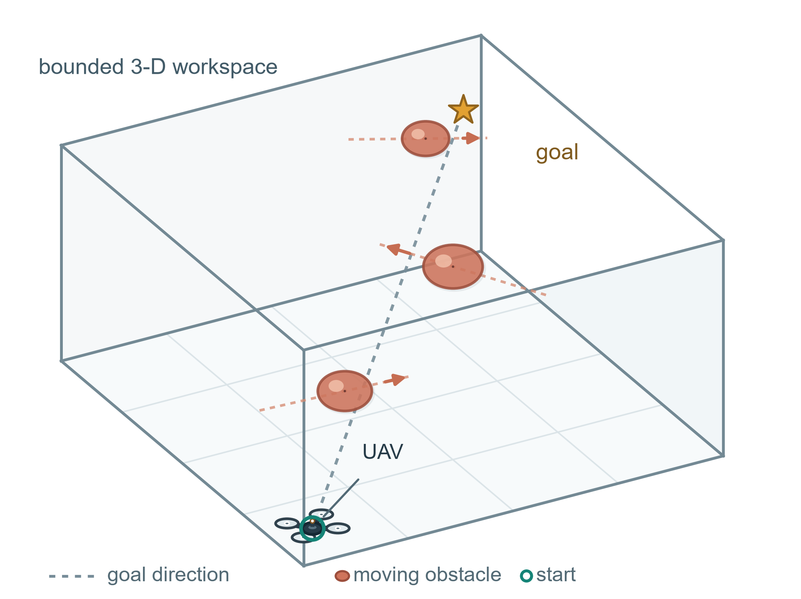
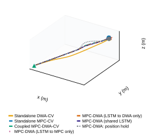
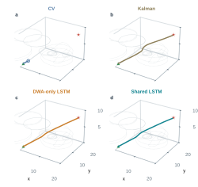
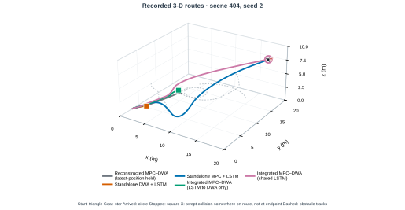

# 论文中英对照全文
**底本说明：** 本稿逐段对应当前 02_source/main.tex。主文报告两套分开分析的仿真证据：一是冻结方案下 500 场景五控制器基准中的共享预测对比（两组各 1,500 次），这 3,000 条记录已包含在 7,500 次基准运行中，不另计样本；二是另一个 100 场景七方法探索性评估（每种方法 300 次，共 2,100 次）。完整五控制器结果和 CV/Kalman 对比均保留在补充材料。4,320 次 Stage-1 记录是独立的开发集权重选择证据，不计入评估结果；Stage-2 尚未完成，也没有真实飞行验证。

## 阅读索引

- Title, abstract, and keywords / 题名、摘要与关键词
- I. Introduction / 引言
- II. Problem Formulation / 问题建模
- III. Planning Method / 规划方法
  - Core equations / 核心公式
  - How the shared forecast is used / 共享预测的使用方式
- IV. Simulation and Results / 仿真与结果
  - Historical comparisons and route examples / 历史对比与路径示例
- V. Discussion / 讨论
- VI. Conclusion / 结论
- Supplementary Methods clarification / 补充方法说明
  - Supplementary Figure S3: retained CV/Kalman route comparison / 补充图 S3：保留的 CV/Kalman 路径对比
  - Supplementary Figure S4: historical scene 404 route example / 补充图 S4：历史场景 404 路径示例
- References / 参考文献

### 公式索引

- [E001 · Eq. (1)](#E001)：无人机运动模型与带符号表面间隙
- [E002 · Eq. (2)](#E002)：CV 与 LSTM 障碍物位置预测
- [E003 · Eq. (3)](#E003)：MPC 目标函数与耦合约束
- [E004 · Eq. (4)](#E004)：信任评分与自适应采样预算
- [E005 · Eq. (5)](#E005)：DWA 安全筛选、评分与 MPC 控制包络

## 题名与作者

**Source:** 02_source/main.tex, title and author

**Original:** A Shared LSTM Forecast for 3-D UAV Planning with Coupled MPC--DWA in Dynamic Obstacle Fields  
Zhenhui Fu*, Beijing University of Chemical Technology, Beijing 100029, China. *Corresponding author: 2025090094@buct.edu.cn.

**中文:** 动态障碍场中共享 LSTM 预测的三维无人机耦合 MPC–DWA 规划  
作者：Zhenhui Fu*；北京化工大学，中国北京 100029。*通讯作者：2025090094@buct.edu.cn。

## Abstract / 摘要

**Source:** 02_source/main.tex, abstract

**Original:** First, a UAV must avoid moving obstacles in three dimensions even when turns, acceleration and pauses make their motion difficult to predict. Second, the method couples model predictive control (MPC) and the dynamic window approach (DWA) through one causal long short-term memory (LSTM) forecast. MPC uses it to optimize a route; DWA screens reachable actions and bounds MPC's first command. Then, in a frozen 500-scene comparison with a 1-s DWA screen, shared LSTM achieved collision-free goal arrival in 936/1,500 runs (62.4%), versus 836/1,500 (55.7%) when only DWA received LSTM. The paired difference was 6.7 percentage points (95% scene-cluster confidence interval, 4.2--9.2). In a separate 100-scene exploratory evaluation with a 3-s DWA screen, sharing reached 73.7%; its contrast with DWA-only LSTM was inconclusive. Standalone MPC-CV reached 92.0%, the highest rate in that evaluation. Finally, the simulations show a gain from forecast sharing under the frozen 1-s DWA protocol, while standalone MPC-CV led the separate 3-s evaluation.

**中文:** 首先，无人机必须在三维空间躲避运动障碍物，即使障碍物转向、加速或暂停也要安全规划。其次，本方法将模型预测控制（MPC）与动态窗口法（DWA）通过同一条因果长短期记忆网络（LSTM）预测相连：MPC 用预测优化路径，DWA 筛选可达动作并约束 MPC 的首个指令。然后，在冻结方案的 500 场景、DWA 滚动时域为 1 s 的对比中，共享 LSTM 有 936/1,500 次无碰撞到达（62.4%），仅向 DWA 输入 LSTM 的方法为 836/1,500 次（55.7%）；配对差为 6.7 个百分点（按场景聚类的 95% 置信区间：4.2–9.2）。在另一个 DWA 时域为 3 s 的 100 场景探索性评估中，共享方法到达率为 73.7%，与仅向 DWA 输入 LSTM 的差异区间包含零；独立 MPC-CV 的到达率最高，为 92.0%。最后，仿真结果显示，共享预测在冻结的 1 s DWA 方案下带来提升，而独立 MPC-CV 在单独的 3 s 评估中到达率最高。

**Source:** 02_source/main.tex, IEEE keywords

**Original:** UAV, 3D path planning, dynamic obstacles, LSTM, model predictive control, dynamic window approach

**中文:** 无人机；三维路径规划；动态障碍物；长短期记忆网络；模型预测控制；动态窗口法。

## I. Introduction / 引言

**Source:** 02_source/main.tex, Introduction, paragraph 1

**Original:** Unmanned aerial vehicles (UAVs) must avoid obstacles that move during flight. Turns, acceleration and pauses make their recent positions unreliable guides to what happens next. Model predictive control (MPC) optimizes a short future route; the dynamic window approach (DWA) chooses a feasible action for the next step [1, 2]. Recent UAV planners also use predicted obstacle motion in MPC [3, 4]. We test whether one causal long short-term memory (LSTM) forecast, shared by MPC and DWA, improves the coupled planner relative to one-layer forecast input, constant-velocity (CV) prediction and standalone controllers. We also compare with a project-local latest-position-hold reconstruction of the MPC--DWA baseline, because the source paper does not specify an executable dynamic-obstacle predictor [5]. The shared forecast connects route optimization to DWA's reachable-action screening and local safety gates.

**中文:** 无人机（UAV）必须避开飞行过程中移动的障碍物。障碍物转向、加速或暂停，使近期位置难以可靠地指示其后续运动。模型预测控制（MPC）优化一段短期路线，动态窗口法（DWA）选择飞行器下一步能够执行的动作 [1, 2]。近期无人机规划研究也将障碍物运动预测用于 MPC [3, 4]。本文检验将同一条因果长短期记忆网络（LSTM）预测共享给 MPC 和 DWA，能否改善耦合规划，并与仅向一层输入预测、恒定速度（CV）预测及独立控制器进行比较。我们还比较了一个基于 MPC–DWA 基线构建的项目内最新位置保持重构，因为原论文未规定可执行的动态障碍物预测器 [5]。共享预测将路线优化与 DWA 的可达动作筛查及局部安全门限连接起来。

## II. Problem Formulation / 问题建模

**Source:** 02_source/main.tex, Problem Formulation

**Original:** We model the UAV as a collision sphere in a bounded 3-D workspace with a start, goal and moving spherical obstacles. Each obstacle has an observed center, radius and time-varying path; future ground-truth positions are hidden from the planner. At each update, it chooses a dynamically feasible action to reach the goal without intersecting an obstacle along the simulated motion. Figure 1 shows the scene geometry; recorded planner paths are compared separately.

**中文:** 我们将无人机建模为一个碰撞球体，在有界三维工作空间内从起点飞向目标，并避让球形移动障碍物。每个障碍物具有观测到的中心、半径和随时间变化的路径；规划器无法获知其未来真实位置。每次更新时，规划器选择满足动力学可行性的动作，以便到达目标且在仿真运动过程中不与障碍物相交。图 1 展示场景几何；记录到的规划器路径另行比较。

### Figure 1 / 图 1：问题几何示意

**Original caption:** Problem geometry: the quadrotor is centered at the start and moves toward the goal among spherical obstacles following prescribed paths (arrows). The dashed line marks the direct start-to-goal direction, not a simulated route; planner trajectories appear separately in Figure 2.

**中文图注：** 问题几何：四旋翼无人机以起点为中心位置，朝目标移动；球形障碍物沿预设路径运动（箭头所示）。虚线表示起点到目标的直达方向，并非仿真路线；规划器轨迹另见图 2。

## III. Planning Method / 规划方法

**Source:** 02_source/main.tex, Planning Method, introductory paragraph

**Original:** With the task geometry defined, we use one causal obstacle forecast to connect route optimization with locally reachable action selection.

**中文:** 明确任务几何后，我们使用同一条因果障碍物预测，将路线优化与局部可达动作选择连接起来。

### Core equations / 核心公式

**Source:** 02_source/main.tex, Core equations, introductory paragraph

**Original:** The vehicle model, causal obstacle forecasts, MPC objective and DWA coupling are collected here. The first four relations update position, speed and attitude; the final relation defines signed surface clearance:

**中文:** 这里汇总飞行器模型、因果障碍物预测、MPC 目标函数以及 DWA 耦合关系。前四个关系更新位置、速度和姿态，最后一个关系定义带符号表面间隙：

**Source:** 02_source/main.tex, Eq. (1), eq:model

$$
\begin{aligned}
\mathbf p_{t+1}&=\mathbf p_t+\Delta t\,v_t[\cos\theta_t\cos\psi_t,\cos\theta_t\sin\psi_t,\sin\theta_t]^{\mathsf T},\\
v_{t+1}&=v_t+\frac{\Delta t}{\tau_v}(v_{c,t}-v_t),\\
\theta_{t+1}&=\theta_t+\Delta t\,\omega_{\theta,t},\quad
\psi_{t+1}=\psi_t+\Delta t\,\omega_{\psi,t},\\
\hat d_{j,k}&=\|\mathbf p_{t+k|t}-\hat{\mathbf o}_{j,t+k|t}\|_2-r_u-r_j.
\end{aligned}
$$

**Source:** 02_source/main.tex, paragraph after Eq. (1)

**Original:** In (1), $t$ and $k$ denote current and future steps; $j=1,\ldots,M$ indexes the $M$ obstacles. The UAV position, speed, pitch and yaw are $\mathbf p$, $v$, $\theta$ and $\psi$; commands $v_c$, $\omega_\theta$ and $\omega_\psi$ set speed and angular rates. The update interval is $\Delta t$, $\tau_v$ is the speed-response time, $r_u$ is the UAV radius and $r_j$ is obstacle $j$'s radius. Thus $\hat d_{j,k}$ is signed surface clearance: positive means separated, zero contact and negative overlap.

**中文:** 在式（1）中，$t$ 和 $k$ 分别表示当前步与未来步；$j=1,\ldots,M$ 为 $M$ 个障碍物的索引。无人机的位置、速度、俯仰角和偏航角分别为 $\mathbf p$、$v$、$\theta$ 和 $\psi$；指令 $v_c$、$\omega_\theta$ 和 $\omega_\psi$ 分别设定速度及角速度。更新间隔为 $\Delta t$，$\tau_v$ 为速度响应时间，$r_u$ 为无人机半径，$r_j$ 为障碍物 $j$ 的半径。因此，$\hat d_{j,k}$ 是带符号表面间隙：正值表示分离，零表示接触，负值表示重叠。

**Source:** 02_source/main.tex, paragraph introducing CV and LSTM forecasts

**Original:** The constant-velocity (CV) baselines extrapolate from the two latest observed positions; at startup, when only one position is available, the initial velocity is set to zero. A separate latest-position-hold baseline keeps the latest observed center fixed over the forecast horizon. The causal LSTM [6] maps ten consecutive observations to thirty three-dimensional offsets from the latest position:

**中文:** 恒定速度（CV）基线根据最近两次观测位置进行外推；启动时若只有一次位置观测，则初始速度设为零。另一个独立的最新位置保持基线则在整个预测时域内固定使用最近观测到的中心位置。因果 LSTM [6] 将连续十次观测映射为以最新位置为基准的 30 个三维偏移量：

**Source:** 02_source/main.tex, Eq. (2), eq:forecast

$$
\begin{aligned}
\hat{\mathbf v}_{j,t}&=(\mathbf o^{\rm obs}_{j,t}-\mathbf o^{\rm obs}_{j,t-1})/\Delta t,\\
\hat{\mathbf o}^{\rm CV}_{j,t+k|t}&=\mathbf o^{\rm obs}_{j,t}+k\Delta t\,\hat{\mathbf v}_{j,t},\\
\mathbf q_{j,s}&=[(\mathbf o^{\rm obs}_{j,s})^{\mathsf T},(\mathbf v^{\rm obs}_{j,s})^{\mathsf T},\cos\chi_{j,s},\sin\chi_{j,s}]^{\mathsf T},\\
\hat{\boldsymbol\delta}_{j,t+1:t+30|t}&=f_{\Theta}(\mathbf q_{j,t-9:t}),\\
\hat{\mathbf o}^{\rm LSTM}_{j,t+k|t}&=\mathbf o^{\rm obs}_{j,t}+\hat{\boldsymbol\delta}_{j,t+k|t}.
\end{aligned}
$$

**Source:** 02_source/main.tex, paragraph after Eq. (2)

**Original:** In (2), $s$ indexes history samples; $\mathbf q$ contains eight features (3-D position, 3-D velocity, and sine/cosine of heading $\chi$), and $f_\Theta$ is the trained LSTM with learned parameters $\Theta$. Here $\mathbf v^{\rm obs}_{j,s}$ is the simulator-provided obstacle velocity, distinct from the finite-difference CV estimate $\hat{\mathbf v}_{j,t}$; $\chi_{j,s}$ is obstacle heading (obstacle yaw), not UAV yaw $\psi_t$. Ten observations span 0.9 s; the LSTM predicts 30 offsets, each anchored to the latest observed center rather than cumulatively summed. At startup, the earliest available state fills missing history. The forecast is causal: at planning time $t$, the network receives only observations through $t$. The benchmark compares configured controllers: LSTM receives simulated position, velocity and heading, whereas CV extrapolates the latest two observed positions. Training details are in Supplementary Methods.

**中文:** 在式（2）中，$s$ 表示历史采样索引；$\mathbf q$ 含八个特征（三维位置、三维速度，以及航向角 $\chi$ 的正弦和余弦），$f_\Theta$ 表示经训练且具有学习参数 $\Theta$ 的 LSTM。这里的 $\mathbf v^{\rm obs}_{j,s}$ 是模拟器提供的障碍物速度，与 CV 根据位置差分得到的 $\hat{\mathbf v}_{j,t}$ 不同；$\chi_{j,s}$ 是障碍物航向（障碍物偏航角），不同于无人机偏航角 $\psi_t$。十次观测覆盖 0.9 s；LSTM 预测 30 个偏移量，每个偏移量均以最新观测中心为基准，而不是逐步累加。系统启动时，以最早可用状态填补缺失历史。该预测具有因果性：在规划时刻 $t$，网络仅接收截至 $t$ 的观测。基准比较的是配置后的控制器：LSTM 接收仿真位置、速度和航向，CV 则根据最近两次观测位置进行外推。训练细节见补充方法。

**Source:** 02_source/main.tex, paragraph introducing the MPC objective and coupling

**Original:** In the shared-LSTM arm, one time-aligned forecast is supplied to both planners so MPC's route and DWA's screened actions anticipate the same obstacle motion. This is designed to align long-horizon route optimization with the near-term action check, rather than plan against two different obstacle futures. MPC uses the forecast to optimize its route, while DWA uses corresponding near-term positions to screen reachable commands. Because MPC represents obstacle safety with soft penalties, DWA also enforces explicit clearance, corridor and braking gates. The accepted DWA actions set per-coordinate bounds on MPC's first command in (3). In the historical DWA-only ablation, LSTM informs DWA while MPC holds the latest observed obstacle positions. The MPC objective and coupling constraints are:

**中文:** 在共享 LSTM 条件下，同一条与时间步对齐的预测同时送入两个规划器，使 MPC 的路线和 DWA 筛选的动作预判相同的障碍物运动。这样设计是为了让长时域路线优化与近期动作检查相互衔接，避免两层依据不同的障碍物未来进行规划。MPC 利用该预测优化路线，DWA 则利用对应的近期位置筛选可达指令。由于 MPC 通过软惩罚表示障碍物安全性，DWA 还会显式执行间隙、飞行走廊和制动门限。通过这些筛查的 DWA 动作共同定义分量级控制盒，并据此约束式（3）中的 MPC 首个指令。历史 DWA-only 消融仅向 DWA 输入 LSTM，而 MPC 保持使用障碍物的最新观测位置。MPC 目标函数与耦合约束如下：

**Source:** 02_source/main.tex, Eq. (3), eq:mpc

$$
\begin{aligned}
\mathbf a&=\mathbf g-\mathbf s,\\
\eta_{\mathbf a}&=\mathbf a^{\mathsf T}\mathbf a+10^{-12}\,\mathrm m^2,\\
P_{\mathbf a}&=I_3-\frac{\mathbf a\mathbf a^{\mathsf T}}{\eta_{\mathbf a}},\\
\mathbf e_{t+k|t}^{\perp}&=P_{\mathbf a}(\mathbf p_{t+k|t}-\mathbf s),\\
J_r&=\sum_{k=1}^{30}\|\mathbf e_{t+k|t}^{\perp}\|_2^2,\\
\min_{\mathbf u_1,\ldots,\mathbf u_{30}}\ J_{\rm MPC}={}&\sum_{k=0}^{29}w_p\|\mathbf p_{t+k|t}-\mathbf g\|_2^2\\
&+\sum_{k=1}^{30}w_u\|\mathbf u_k\|_2^2\\
&+w_f\|\mathbf p_{t+30|t}-\mathbf g\|_2^2+w_rJ_r\\
&+w_{\Delta u}\sum_{k=2}^{30}\|\mathbf u_k-\mathbf u_{k-1}\|_2^2\\
&+\sum_{k=1}^{30}\sum_{j=1}^{M}w_o[-\hat d_{j,k}]_+^2\\
&+\sum_{k=1}^{30}\sum_{j=1}^{M}w_s[d_{\rm soft}-\hat d_{j,k}]_+^2,\\
&\text{subject to }\mathbf x_{t|t}=\mathbf x_t,\\
&\mathbf x_{t+k|t}=f(\mathbf x_{t+k-1|t},\mathbf u_k),\\
&\qquad k=1,\ldots,30,\\
&\mathbf u_k\in[0,2.0]\times[-0.8,0.8]^2,\\
&\mathbf u_1\in\mathcal U_t\quad\text{when }\mathcal A_t\ne\varnothing,\\
&|\mathbf u_k-\mathbf u_{k-1}|\preceq\mathbf a_u\Delta t,\\
&\qquad k=1,\ldots,30.
\end{aligned}
$$

**Source:** 02_source/main.tex, paragraph after Eq. (3)

**Original:** Here $\mathbf x_t=[\mathbf p_t^{\mathsf T},\theta_t,\psi_t,v_t]^{\mathsf T}$ is the position--pitch--yaw--speed state; $f$ is defined by the first four state-update relations in (1). The MPC command is $\mathbf u_k=[v_{c,k},\omega_{\theta,k},\omega_{\psi,k}]^{\mathsf T}$; $\mathbf u_0$ is the last applied DWA command and $\mathbf a_u$ gives componentwise rate limits. The physical input box means commanded speed is 0--2.0 m s$^{-1}$ and each angular rate is limited to $\pm0.8$ rad s$^{-1}$. In the rate constraint, absolute value and $\preceq$ act componentwise: at each step, each command component can change by at most its corresponding limit in $\mathbf a_u$ multiplied by $\Delta t$. The start and goal are $\mathbf s,\mathbf g$, and $\mathbf a=\mathbf g-\mathbf s$ is the route vector. The scalar $\eta_{\mathbf a}$ is its squared length plus the implementation's $10^{-12}\,\mathrm m^2$ numerical safeguard; $P_{\mathbf a}$ is the resulting regularized cross-track operator, and $J_r$ penalizes the residual distance from the direct line. $I_3$ is the 3-D identity. The index $k$ runs over the prediction horizon and $\hat d_{j,k}$ is signed clearance for obstacle $j$; MPC adds a $10^{-12}\,\mathrm m^2$ numerical smoothing term when evaluating distance, whereas DWA and swept-collision checks use the exact norm. Weights $w_p,w_u,w_f,w_r,w_{\Delta u},w_o,w_s$ penalize, in order, stage goal error, control effort, terminal goal error, route deviation, command changes, overlap and clearance below $d_{\rm soft}=0.35$ m. The positive-part operator is $[x]_+=\max(0,x)$, so a penalty activates only when its clearance threshold is violated. The implementation squares native command values without cross-channel normalization, making the effort term a heuristic scalarization rather than a dimensionally homogeneous physical cost; numerical weights and command limits are given in Supplementary Methods. The MPC solver imposes no separate state-box bounds. When the normal safe set $\mathcal A_t$ is nonempty, accepted DWA actions define a coordinate-wise box $\mathcal U_t$ for MPC's first input; the box may contain actions DWA did not screen and is not itself a safety certificate for every enclosed action.

**中文:** 这里，$\mathbf x_t=[\mathbf p_t^{\mathsf T},\theta_t,\psi_t,v_t]^{\mathsf T}$ 是由位置、俯仰角、偏航角和速度组成的状态；$f$ 由式（1）中前四个状态更新关系定义。MPC 指令为 $\mathbf u_k=[v_{c,k},\omega_{\theta,k},\omega_{\psi,k}]^{\mathsf T}$；$\mathbf u_0$ 是最近一次实际执行的 DWA 指令，$\mathbf a_u$ 给出各分量的变化率限值。物理输入范围表示期望速度为 0–2.0 m s$^{-1}$，俯仰角速度和偏航角速度分别限制在 $\pm0.8$ rad s$^{-1}$。在变化率约束中，绝对值和 $\preceq$ 均按分量计算：每一步内，各控制指令分量的变化量不得超过 $\mathbf a_u$ 中相应限值乘以 $\Delta t$。起点和目标分别为 $\mathbf s,\mathbf g$，$\mathbf a=\mathbf g-\mathbf s$ 是起点到目标的路线向量。标量 $\eta_{\mathbf a}$ 是路线长度平方加上实现中的 $10^{-12}\,\mathrm m^2$ 数值保护项；$P_{\mathbf a}$ 是相应的正则化横向偏差算子，$J_r$ 惩罚预测位置到直达路线的横向残差。$I_3$ 是三维单位矩阵。索引 $k$ 遍历预测时域，$\hat d_{j,k}$ 是相对于障碍物 $j$ 的带符号间隙；MPC 计算距离时加入 $10^{-12}\,\mathrm m^2$ 的数值平滑项，而 DWA 与扫掠碰撞检查使用精确范数。权重 $w_p,w_u,w_f,w_r,w_{\Delta u},w_o,w_s$ 依次惩罚阶段目标误差、控制消耗、终端目标误差、路线偏差、指令变化、重叠以及低于 $d_{\rm soft}=0.35$ m 的间隙。正部算子为 $[x]_+=\max(0,x)$，仅当对应的间隙门限被违反时相应惩罚才非零。实现中直接对各自原生单位的控制指令数值平方求和，未作通道间归一化，因此该控制代价是启发式标量化，不是量纲齐次的物理能量；数值权重和控制限值列于补充方法。MPC 求解器不设置单独的状态盒约束。当普通安全集 $\mathcal A_t$ 非空时，通过筛选的 DWA 动作为 MPC 首个输入的各坐标定义控制范围；该范围可能包含 DWA 未筛查过的动作，因此不等于对范围内所有动作的安全保证。

**Source:** 02_source/main.tex, trust-score introduction

**Original:** Trust score $\tau$ combines predicted safety, goal progress, agreement with the previous MPC guide, and control smoothness. It sets the sample budget and guided/exploratory split. Components and weights lie in $[0,1]$; weights sum to one.

**中文:** 信任评分 $\tau$ 综合预测安全性、目标推进、与上一轮 MPC 引导路线的一致程度以及控制平滑性。它用于设定采样预算，并划分引导采样与探索采样。各评分分量和权重均在 $[0,1]$ 内，权重之和为 1。

**Source:** 02_source/main.tex, Eq. (4), eq:trust

$$
\begin{aligned}
\tau&=\sigma_s\tau_{\rm sa}+\sigma_g\tau_g\\
&+\sigma_t\tau_{\rm ref}+\sigma_m\tau_{\rm sm},\\
\Delta_p&=\|\mathbf p_t-\mathbf p_{\mathrm{ref},1|t-1}\|_2,\\
\tau_{\rm ref}&=\exp(-\alpha_T\Delta_p),\\
B&=\operatorname{round}[300(1+\alpha e^{-\beta\tau})],\\
B_g&=\operatorname{round}(B\tau),\quad B_e=B-B_g.
\end{aligned}
$$

**Source:** 02_source/main.tex, paragraph after Eq. (4)

**Original:** In (4), $\sigma_s,\sigma_g,\sigma_t,\sigma_m$ weight safety, goal progress, reference tracking and smoothness; they sum to one, and $\sigma_t$ denotes tracking rather than time. The reference position $\mathbf p_{\mathrm{ref},1|t-1}$ is the first predicted point on the previous MPC route, so $\Delta_p$ measures the distance from the current UAV position to that guide. By definition, $\tau_{\rm ref}$ decreases as this distance grows; the implementation names this tracking score $\tau_t$. At startup, scores use the initial MPC solution; later they use the shifted route and controls. The four scores measure clearance-based safety, route progress, agreement with the previous route's first point and control smoothness; their full definitions are in Supplementary Methods S1.2. The historical benchmark retained inherited weights $[0.35,0.30,0.15,0.20]$, not tuned on its 500 scenes. A separate 4,320-episode development sweep (six vectors, five integrated branches, 48 scenes and three matched seeds) selected $[0.15,0.15,0.15,0.55]$, with equal-arm macro-average collision-free arrival of 0.8042 (branch rates in Supplementary Methods S1.2). Because the same runs selected the vector, this score is descriptive, not held-out evidence: the historical benchmark retained its inherited vector, while the current 100-scene evaluation uses the selected vector. The reference-decay setting $\alpha_T=3$ m$^{-1}$ and dimensionless budget-sensitivity setting $\beta=3$ remained fixed and were not selected by the incomplete Stage-2 grid. $B$ is split into MPC-guided ($B_g$) and exploratory ($B_e$) samples, and the clipped MPC command is also tested. The dimensionless budget gain $\alpha=1$ is distinct from $\alpha_T$; higher trust reduces exploration and sample count, 300 is the base budget, and $\beta$ sets sensitivity.

**中文:** 在式（4）中，$\sigma_s$、$\sigma_g$、$\sigma_t$ 和 $\sigma_m$ 分别对安全性、目标推进、参考跟踪和控制平滑性加权，权重之和为 1；$\sigma_t$ 表示跟踪项而非时间。$\mathbf p_{\mathrm{ref},1|t-1}$ 是上一轮 MPC 路线预测的第一个位置，因此 $\Delta_p$ 表示当前无人机位置与该引导点之间的距离。按定义，距离越大，$\tau_{\rm ref}$ 越低；代码中该跟踪评分命名为 $\tau_t$。启动时，各评分使用初始 MPC 解；之后使用移位后的路线和控制序列。四个评分依次表示基于间隙的安全性、路线推进、与上一轮路线首个预测点的一致程度，以及控制平滑性；完整定义见补充方法 S1.2。历史基准保留继承权重 $[0.35,0.30,0.15,0.20]$，未在其 500 个场景上调参。另有一项 4,320 次仿真的开发集权重搜索，比较六组候选向量、五个集成分支、48 个开发场景和每场景三个匹配种子，选出 $[0.15,0.15,0.15,0.55]$；五个分支等权宏平均无碰撞到达率为 0.8042（各分支开发率见补充方法 S1.2）。由于同一批运行用于选择向量，该数值属于校准描述，不是留出验证：历史基准保留继承向量，当前 100 场景探索性评估使用仿真选出的向量。参考衰减系数 $\alpha_T=3$ m$^{-1}$ 和无量纲预算敏感度 $\beta=3$ 保持固定，且未由未完成的 Stage-2 网格选出。$B$ 分为 MPC 引导样本 $B_g$ 和探索样本 $B_e$，裁剪后的 MPC 指令也会加入候选。无量纲预算增益 $\alpha=1$ 与 $\alpha_T$ 不同；信任度越高，探索比例和采样总数越低，基础预算为 300，$\beta$ 控制敏感度。

**Source:** 02_source/main.tex, DWA screening and scoring introduction

**Original:** DWA rejects candidate $b$ unless its rollout meets the clearance, flight-corridor and braking checks. It ranks the remaining actions and uses their per-coordinate ranges to bound MPC's first control:

**中文:** 除非候选动作 $b$ 的滚动轨迹通过间隙、飞行走廊和制动检查，否则 DWA 会将其剔除。随后，DWA 对剩余动作排序，并依据各控制分量的范围约束 MPC 的首个控制量：

**Source:** 02_source/main.tex, Eq. (5), eq:dwa

$$
\begin{aligned}
\mathcal A_t&=\{b:d_{\min}^{(b)}>0.25~\mathrm m,\ \mathcal C_b=1,\\
&\hspace{1em}(v_{\rm end}^{(b)})^2\leq2a_{\max}d_{\min}^{(b)}\},\\
S_b&=w_p^{\mathrm{DWA}}S_{p,b}+w_h^{\mathrm{DWA}}S_{h,b}\\
&+w_v^{\mathrm{DWA}}S_{v,b}+w_o^{\mathrm{DWA}}S_{o,b}+w_zS_{z,b},\\
b^*&=\arg\max_{b\in\mathcal A_t}S_b,\\
u_{i,t}^{-}&=\max(u_i^{\min},\min_{b\in\mathcal A_t}u_i^{(b)}-\delta),\\
u_{i,t}^{+}&=\min(u_i^{\max},\max_{b\in\mathcal A_t}u_i^{(b)}+\delta),\\
\mathcal U_t&=\prod_{i=1}^{3}[u_{i,t}^{-},u_{i,t}^{+}].
\end{aligned}
$$

**Source:** 02_source/main.tex, paragraph after Eq. (5)

**Original:** In (5), $d_{\min}^{(b)}$ is candidate $b$'s smallest discrete surface clearance over all obstacles and sampled rollout states; $\mathcal C_b=1$ means its rollout stays inside the flight corridor. A candidate is retained only when that minimum exceeds 0.25 m and the stopping-distance test passes; $v_{\rm end}^{(b)}$ and $a_{\max}$ are terminal speed and available deceleration. Scores $S_p,S_h,S_v,S_o$ measure MPC-endpoint agreement, heading agreement, speed tracking with a forward-speed reward, and normalized obstacle clearance; $S_z$ penalizes vertical-profile deviation. Trust-dependent weights on the first four scores sum to one; $w_z=0.25$ is fixed and not renormalized. The margin $\delta=0.1$ is applied separately to each command coordinate (not as one shared physical distance) to expand the screened candidates' range; $i$ indexes speed, pitch rate and yaw rate, and $u_i^{\min},u_i^{\max}$ are physical limits. The top-scoring safe candidate is normally applied. A yaw-rate correction is triggered when the selected rollout's minimum predicted clearance exceeds 1.0 m while the UAV's current horizontal cross-track offset from the start--goal line exceeds 0.5 m; the adjusted command is re-screened by the same clearance, corridor and braking tests, and the original safe command is restored if it fails. Collision outcomes are independently checked on continuous swept paths. If the normal set is empty, the emergency branch is screened and the run stops if none passes. Full score formulas and settings are in Supplementary Methods.

**中文:** 在式（5）中，$d_{\min}^{(b)}$ 是候选动作 $b$ 在所有障碍物和滚动轨迹采样状态中的最小离散表面间隙；$\mathcal C_b=1$ 表示整条轨迹都处于飞行走廊内。只有当该最小间隙大于 0.25 m 且通过制动距离检查时，候选动作才会保留；$v_{\rm end}^{(b)}$ 和 $a_{\max}$ 分别表示末端速度和可用减速度。评分 $S_p,S_h,S_v,S_o$ 分别衡量与 MPC 端点的一致程度、航向一致性、速度跟踪及前向速度奖励、以及归一化障碍物间隙；$S_z$ 惩罚垂直剖面偏差。前四项评分的信任度相关权重之和为 1；固定权重 $w_z=0.25$ 不再归一化。裕度 $\delta=0.1$ 分别应用于各个控制坐标（不是一个共用的物理距离），用来扩展通过筛查的候选范围；$i$ 索引速度、俯仰角速度和偏航角速度，$u_i^{\min},u_i^{\max}$ 为物理限值。通常执行得分最高的安全候选动作。若所选滚动轨迹的最小预测间隙超过 1.0 m，且当前无人机位置相对起点—目标线的水平横向偏移超过 0.5 m，则触发偏航角速度修正，使航向转向目标方向；修正后的指令会再次接受相同的间隙、走廊和制动检查，若未通过则恢复原安全指令。碰撞结果另依据连续扫掠路径独立检查。若普通安全集为空，则筛查应急分支；若没有应急动作通过，运行即停止。完整评分公式与设置见补充方法。

### How the shared forecast is used / 共享预测的使用方式

**Source:** 02_source/main.tex, How the shared forecast is used

**Original:** At each 0.1-s update, the shared arm sends the same causal 3-s LSTM forecast to MPC and DWA. MPC optimizes a 30-step route; DWA screens reachable 30-step actions against that forecast, and its passing actions bound MPC's first command on re-solve. The updated MPC route guides the next DWA ranking, while the screened DWA action is executed. In the one-layer ablations, only the named layer receives LSTM predictions and the other uses CV; independent DWA and MPC use CV, and the no-forecast comparator holds the latest obstacle positions. The complete cycle and fallback are in Supplementary Methods S1.4.

**中文:** 每个 0.1 s 更新周期，共享组将同一条因果 3 s LSTM 预测送入 MPC 和 DWA。MPC 优化 30 步路线；DWA 针对同一预测筛查可达的 30 步动作，通过筛查的动作范围会在重求解时约束 MPC 的首个控制量。更新后的 MPC 路线用于下一轮 DWA 排序，实际执行的是通过筛查的 DWA 动作。在单层消融中，只有指定层接收 LSTM 预测，另一层使用 CV；独立 DWA 和 MPC 均使用 CV；无预测对照则在预测时域内保持最新观测到的障碍物位置。完整循环及回退流程见补充方法 S1.4。

## IV. Simulation and Results / 仿真与结果

**Source:** 02_source/main.tex, Simulation and Results, opening paragraph

**Original:** Under the frozen 1-s DWA/3-s MPC protocol and inherited weights, 500 scenes (three matched seeds each) compared shared LSTM with DWA-only LSTM. DWA received LSTM forecasts in both arms; only shared LSTM also supplied them to MPC. Safe arrival was 936/1,500 (62.4%) versus 836/1,500 (55.7%; +6.7 percentage points, 95% scene-cluster CI, 4.2--9.2). These 3,000 records belong to the 7,500-run five-controller benchmark, not an additional sample; full outcomes and protocol are in Supplementary Methods S4. Separately, an exploratory seven-arm comparison tested 100 scenes (three matched seeds; 300 runs per arm) using 0.1-s updates, 30-step (3-s) MPC/DWA horizons and a 650-step limit. Arms were standalone DWA-CV and MPC-CV, coupled MPC--DWA-CV, LSTM-to-MPC-only, LSTM-to-DWA-only, shared LSTM and latest-position-hold MPC--DWA. Safe arrival required goal tolerance without swept-path contact. Seeds were averaged within scene; 20,000 scene-cluster bootstrap resamples produced simultaneous max-|t| intervals for six shared-versus-comparator contrasts. The scene bank was distinct from the 500-scene benchmark.

**中文:** 在冻结的 1 s DWA/3 s MPC 方案及继承的信任权重下，我们在 500 个场景（每个场景三个匹配种子）中比较共享 LSTM 与仅 DWA 使用 LSTM。两组的 DWA 均接收 LSTM 预测；只有共享组还将预测输入 MPC。共享组有 936/1,500 次无碰撞到达（62.4%），仅 DWA 使用 LSTM 组为 836/1,500 次（55.7%；配对差 6.7 个百分点，按场景聚类的 95% CI：4.2–9.2）。这 3,000 条记录属于既有 7,500 次五控制器基准，不是额外运行；完整结果和方案见补充方法 S4。另一个探索性七方法评估在 100 个场景中进行（每场景三个匹配种子，每方法 300 次），控制器每 0.1 s 更新，MPC/DWA 时域均为 30 步（3 s），最多运行 650 步。方法包括独立 DWA-CV、独立 MPC-CV、耦合 MPC–DWA-CV、仅 MPC 使用 LSTM、仅 DWA 使用 LSTM、共享 LSTM，以及最新位置保持 MPC–DWA。安全到达要求进入目标容差且连续扫掠路径无接触。我们在场景内平均三个种子，并进行 20,000 次按场景聚类的 bootstrap；六个共享组对比采用同时 max-|t| 区间。该评估使用不同的场景库。

### Figure 2 / 图 2：七方法三维路径对比

**Original caption:** Recorded simulated 3D paths for all seven methods in scene 79, seed 2. This post hoc case was the only one of 300 matched sets in which shared LSTM arrived without contact and the other methods did not reach the goal. One baseline had swept contact; five stopped without contact. Paths show saved positions only through each true terminal state, with no smoothing, resampling or extension. Triangle/star: start/goal; circles: safe arrivals; squares: no-contact non-arrivals; X: terminal point of a run with swept contact, not the contact location. Colors and line styles identify methods. Obstacle geometry is omitted here; Figure 1 shows the scenario schematic. Axes are in metres; Table 1 reports all outcomes.

**中文图注：** 图 2 展示场景 79、采样种子 2 中七种方法的仿真三维轨迹。本例为事后选择；在 300 个匹配组合中，仅此一组由共享 LSTM 无接触到达目标，其他方法均未到达。其中一个基线发生扫掠接触，另外五种无接触停止。轨迹仅绘制已保存的位置，并截止于真实终止状态，不做平滑、重采样或延伸。三角形/星形表示起点/目标；圆圈表示安全到达，方块表示无接触未到达，X 表示发生扫掠接触运行的终止点（并非接触位置）。颜色和线型区分方法。图中不重复绘制障碍物几何，场景示意见图 1。坐标单位为米；总体结果见表 1。

**Source:** 02_source/main.tex, first results paragraph

**Original:** In the 3-s evaluation, shared LSTM reached safely in 221/300 runs (73.7%), 16.3 points above position-hold (simultaneous 95% CI, 5.1--27.6) but 18.3 below MPC-CV (-29.6 to -7.0). Intervals versus DWA-CV, coupled CV and both one-layer LSTM arms, including DWA-only, included zero. Standalone MPC-CV ranked highest; shared LSTM exceeded position-hold, while its DWA-only contrast was inconclusive.

**中文:** 在 3 s 时域评估中，共享 LSTM 有 221/300 次无碰撞到达目标（73.7%），比最新位置保持组高 16.3 个百分点（同时 95% CI：5.1–27.6），比独立 MPC-CV 低 18.3 个百分点（−29.6 至 −7.0）。相对独立 DWA-CV、耦合 CV 和两个单层 LSTM 组（包括仅 DWA 使用 LSTM）的区间均包含零。独立 MPC-CV 的到达率最高；共享 LSTM 超过位置保持基线，与仅 DWA 使用 LSTM 的差异尚不确定。

### Table 1 / 表 1：七方法探索性仿真结果

**Original caption:** Outcome summary for the exploratory simulation (n=300 episodes per arm). Safe arrival requires reaching the goal without swept-path contact. Full paired intervals are in Supplementary Table S12.

**中文表注：** 本探索性仿真中每种方法运行 300 次。安全到达要求到达目标且连续扫掠路径上没有接触。完整配对区间见补充材料表 S12。

| Controller / 控制器 | Safe-goal rate (%) / 安全到达率（%） | Swept contacts / 扫掠接触 |
|---|---:|---:|
| Standalone DWA-CV / 独立 DWA-CV | 78.0 | 0 |
| Standalone MPC-CV / 独立 MPC-CV | 92.0 | 15 |
| Coupled MPC–DWA-CV / 耦合 MPC–DWA-CV | 68.0 | 0 |
| MPC–DWA (LSTM to MPC only) / MPC–DWA（仅 MPC 使用 LSTM） | 73.0 | 0 |
| MPC–DWA (LSTM to DWA only) / MPC–DWA（仅 DWA 使用 LSTM） | 74.7 | 0 |
| MPC–DWA (shared LSTM) / MPC–DWA（共享 LSTM） | **73.7** | **0** |
| MPC–DWA (latest-position hold) / MPC–DWA（最新位置保持） | 57.3 | 50 |

### Historical five-controller comparison / 历史五控制器对比

**Source:** 03_supplementary/supplementary_methods.tex, S4.2–S4.3

**Original:** The historical five-controller study used 500 scenes with three matched seeds per scene (1,500 episodes per arm), a 1-s DWA rollout and a 30-step MPC horizon. Shared LSTM reached the goal without contact in 936/1,500 episodes (62.4%), compared with 33/1,500 (2.2%) for latest-position hold and 836/1,500 (55.7%) for LSTM-to-DWA-only integration. The paired differences were +60.2 percentage points (95% scene-cluster CI, +56.2 to +64.2) and +6.7 points (+4.2 to +9.2), respectively. Standalone DWA+LSTM and MPC+LSTM reached in 1,236/1,500 (82.4%) and 1,428/1,500 (95.2%). Shared integration was lower than these arms by 20.0 points (95% CI, -24.8 to -15.1) and 32.8 points (-37.1 to -28.5). This historical 1-s study is separate from the current seven-method, 3-s-horizon evaluation.

**中文:** 历史五控制器研究在 500 个场景、每场景三个匹配种子上进行测试（每种方法 1,500 次），DWA 滚动时域为 1 s，MPC 时域为 30 步。共享 LSTM 在 1,500 次运行中有 936 次无接触到达目标（62.4%）；最新位置保持组为 33/1,500 次（2.2%），仅向 DWA 输入 LSTM 的集成组为 836/1,500 次（55.7%）。相应配对差异为 +60.2 个百分点（按场景聚类的 95% CI：+56.2 至 +64.2）和 +6.7 个百分点（+4.2 至 +9.2）。独立 DWA+LSTM 和 MPC+LSTM 分别有 1,236/1,500 次（82.4%）和 1,428/1,500 次（95.2%）到达。共享集成方法分别低 20.0 个百分点（95% CI：−24.8 至 −15.1）和 32.8 个百分点（−37.1 至 −28.5）。这项历史 1 s 研究与当前七方法、3 s 时域评估相互独立。

### Historical Table / 历史表：五控制器研究结果

**Original caption:** Retained results from the historical five-controller study (500 scenes, three matched seeds and 1,500 runs per method; 1-s DWA screening). The latest-position-hold MPC--DWA is a project-local reconstruction, not an exact reproduction.

**中文表注：** 保留的历史五控制器研究结果（500 个场景、每场景三个匹配种子，每种方法 1,500 次；DWA 筛查时域为 1 s）。最新位置保持 MPC–DWA 是项目内重构，并非精确复现。

| Controller / 控制器 | Goal without collision / 无碰撞到达目标 | Swept collision runs / 扫掠碰撞运行次数 |
|---|---:|---:|
| MPC–DWA reconstruction (position hold) / MPC–DWA 重构（位置保持） | 33/1,500 (2.2%) | 624 (41.6%) |
| Integrated MPC–DWA (LSTM to DWA only) / 集成 MPC–DWA（仅 DWA 使用 LSTM） | 836/1,500 (55.7%) | 2 (0.13%) |
| Integrated MPC–DWA (shared LSTM) / 集成 MPC–DWA（共享 LSTM） | **936/1,500 (62.4%)** | **0 (0%)** |
| Standalone DWA + LSTM / 独立 DWA + LSTM | 1,236/1,500 (82.4%) | 0 (0%) |
| Standalone MPC + LSTM / 独立 MPC + LSTM | 1,428/1,500 (95.2%) | 36 (2.4%) |

## V. Discussion / 讨论

**Source:** 02_source/main.tex, Discussion, paragraph 1

**Original:** The two protocols indicate a protocol-specific benefit: forecast sharing raised safe arrival in the frozen 1-s screen comparison, but not in the 3-s exploratory comparison; standalone MPC-CV had the highest rate there. Because scene banks, trust weights and horizons also differed, these studies do not isolate the source of that difference. LSTM uses simulator-recorded obstacle velocity and heading, whereas CV estimates velocity from positions, so the contrast concerns configured input pipelines as well as predictors. Prescribed tracks, point forecasts and no flight tests limit generalization.

**中文:** 两套方案显示出协议特定的结果：在冻结的 1 s DWA 筛查对比中，共享预测提高了安全到达率；在 3 s 探索性对比中未显示这一优势，而独立 MPC-CV 的到达率最高。由于两套方案的场景库、信任权重和时域也不同，当前证据无法定位造成差异的具体因素。LSTM 使用模拟器记录的障碍物速度和航向，CV 则根据位置估计速度，因此比较涉及具体输入流程，而非只比较预测器。预设轨迹、点预测和未进行实机飞行限制了泛化结论。

## VI. Conclusion / 结论

**Source:** 02_source/main.tex, Conclusion

**Original:** In simulation, shared LSTM increased collision-free arrival by 6.7 percentage points over DWA-only input in the frozen 500-scene, 1-s DWA comparison. In the separate 3-s evaluation, standalone MPC-CV had the highest rate, and the shared-versus-DWA-only contrast was inconclusive.

**中文:** 在仿真中，冻结的 500 场景、1 s DWA 对比显示，共享 LSTM 相较仅向 DWA 输入预测，无碰撞到达率提高了 6.7 个百分点。在单独的 3 s 评估中，独立 MPC-CV 的到达率最高；共享方法与仅 DWA 使用 LSTM 的差异尚不确定。

## Supplementary Methods clarification / 补充方法说明

**Source:** ../03_supplementary/supplementary_methods.tex, S1.2–S1.3

**Original:** Smoothness uses consecutive MPC control increments $\Delta\mathbf u_k=\mathbf u_k-\mathbf u_{k-1}$. The score is $\tau_{\rm sm}=\operatorname{clip}_{[0,1]}\!\left[1-\frac{1}{3(N-1)}\sum_{i=1}^{3}\sum_{k=2}^{N}\frac{|\Delta u_{k,i}|}{a_{u,i}\Delta t}\right]$.

Here $i$ indexes desired speed, pitch rate and yaw rate; $N=30$, $\Delta t=0.1$ s, and $\mathbf a_u=[1~\mathrm{m\,s^{-2}},\ 0.5~\mathrm{rad\,s^{-2}},\ 0.5~\mathrm{rad\,s^{-2}}]^{\mathsf T}$. At startup, the initial MPC solution initializes the aligned reference and control sequence; thereafter, the preceding solution is shifted before the trust scores are computed. Guided controls are sampled within $r_{\rm Guide}=0.35$ per control component of the clipped MPC command, then clipped to the dynamic window. The logistic map is $q=[1+\exp(-8(\tau-0.5))]^{-1}$. The half-width 0.35, slope 8, midpoint 0.5 and additive vertical-score coefficient $w_z=0.25$ are fixed implementation heuristics, held constant in every integrated arm that uses them and not selected using held-out outcomes. The half-width uses native control units ($\mathrm{m\,s^{-1}}$ for speed and $\mathrm{rad\,s^{-1}}$ for pitch and yaw rates); slope and midpoint are dimensionless. The $w_z$ term is added after the four normalized DWA weights and is not renormalized with them.

**中文:** 平滑度分量使用相邻 MPC 控制量的增量 $\Delta\mathbf u_k=\mathbf u_k-\mathbf u_{k-1}$。其评分定义为 $\tau_{\rm sm}=\operatorname{clip}_{[0,1]}\!\left[1-\frac{1}{3(N-1)}\sum_{i=1}^{3}\sum_{k=2}^{N}\frac{|\Delta u_{k,i}|}{a_{u,i}\Delta t}\right]$。其中，$i$ 依次表示期望速度、俯仰角速度和偏航角速度；$N=30$，$\Delta t=0.1$ s，且 $\mathbf a_u=[1~\mathrm{m\,s^{-2}},\ 0.5~\mathrm{rad\,s^{-2}},\ 0.5~\mathrm{rad\,s^{-2}}]^{\mathsf T}$。启动时，以初始 MPC 解初始化对齐后的参考路线与控制序列；此后在计算信任评分前，对上一周期解进行时移。引导控制在裁剪后的 MPC 指令周围按每个控制分量的 $r_{\rm Guide}=0.35$ 半宽采样，随后裁剪到动态窗口内。逻辑映射为 $q=[1+\exp(-8(\tau-0.5))]^{-1}$。半宽 0.35、斜率 8、中点 0.5 和附加垂直评分系数 $w_z=0.25$ 均为固定实现启发式参数；所有使用这些参数的集成分支均保持不变，且未依据留出结果选择。半宽采用各控制量的原生单位（速度为 $\mathrm{m\,s^{-1}}$，俯仰和偏航角速度为 $\mathrm{rad\,s^{-1}}$）；斜率和中点无量纲。$w_z$ 项在四个归一化 DWA 权重之后加入，且不与它们一起重新归一化。

**Source:** ../scripts/run_v12a_pooled_weight_development.m:123,164; ../04_review/v12a_stage1_recovery_audit_20261014.md:5,9,13

**Original:** The Stage-1 trust-weight calibration evaluated six candidate vectors across five trust-using integrated MPC--DWA branches, 48 development scenes and three matched seeds ($6\times5\times48\times3=4{,}320$ simulation episodes). The selected vector $[0.15,0.15,0.15,0.55]$ had an equal-arm macro-average collision-free arrival rate of 0.8042. Development rates were 0.8958 for shared LSTM, 0.7431 for CV-coupled MPC--DWA, 0.8194 for LSTM-to-MPC-only, 0.8958 for LSTM-to-DWA-only and 0.6667 for latest-position hold. These are selection-set descriptions, not held-out comparisons. The earlier 864-episode six-setting comparison used a different protocol and was not reused; a separate recovery audit validated all 4,320 Stage-1 episode records without creating new simulations.

**中文:** 阶段 1 信任权重校准在五种使用信任评分的集成 MPC--DWA 分支、48 个开发场景和每场景 3 个匹配种子上评估六个候选向量（$6\times5\times48\times3=4{,}320$ 次仿真）。选出的向量为 $[0.15,0.15,0.15,0.55]$，其五分支等权宏平均无碰撞到达率为 0.8042。开发率分别为：共享 LSTM 0.8958、CV 耦合 MPC--DWA 0.7431、仅 MPC 使用 LSTM 0.8194、仅 DWA 使用 LSTM 0.8958、最新位置保持 0.6667。这些是用于选参的开发集描述值，不是留出对比结果。此前 864 次六设置实验采用不同协议，未用于本次选择；单独的恢复审计对全部 4,320 条记录进行了校验，没有新增仿真。

### Historical route illustrations / 历史路径示例

### Figure 3 / 图 3：Supplementary Figure S3，保留的 CV/Kalman 历史路径

**Source:** 03_supplementary/supplementary_methods.tex, Fig. historical-scene2

**Original caption:** Historical four-method 3-D route example from scene 2 and DWA sampling seed 1. Panels (a)--(d) show CV, Kalman, DWA-only LSTM and shared LSTM under the same prescribed obstacle tracks. The green triangle marks the start, the red star the goal, and the open circle CV's recorded early-stop endpoint. In this example, CV stopped before the goal; the other three methods reached the goal, and all four routes were collision-free under the swept-path test. Each route contains only its saved states through the recorded terminal point; none is extended or interpolated. Obstacle tracks show scene context and are not time-aligned with route durations. This single historical example illustrates route geometry, not aggregate performance, and is reported separately from the historical five-controller benchmark and current seven-method evaluation.

**中文图注：** 历史四方法三维路径示例，取自场景 2、DWA 采样种子 1。(a)–(d) 分别为 CV、Kalman、仅 DWA 使用 LSTM 和共享 LSTM，使用相同的预设障碍物轨迹。绿色三角表示起点，红色星形表示目标点，空心圆表示 CV 记录的提前停止位置。在该例中，CV 未到达目标；其余三种方法到达目标，且四条轨迹均未发生扫掠碰撞。每条路线仅包含已记录状态，并截止于实际终止点，不外延或插值。障碍物轨迹仅作为场景背景，未与各方法的飞行时长进行时间对齐。该单个历史示例展示路径形状，不代表总体性能；其结果与历史五控制器基准及当前七方法评估分开报告。

### Figure 4 / 图 4：Supplementary Figure S4, historical scene 404 routes / 补充图 S4：历史场景 404 路径

**Source:** 03_supplementary/supplementary_methods.tex, S7, Fig. primaryroutes

**Original caption:** Historical five-controller 3-D routes from scene 404, seed 2 in the 1-s DWA-screening study. The recorded paths end at their logged terminal states: latest-position-hold MPC--DWA (collision, step 224); standalone DWA + LSTM (stopped, step 20); standalone MPC + LSTM (collision, step 262); integrated MPC--DWA with LSTM to DWA only (stopped, step 220); and integrated MPC--DWA with shared LSTM (collision-free arrival, step 253). Only the shared controller arrived in this illustrative case; aggregate historical outcomes are in Table T002 and Supplementary Methods S4.3. Dashed lines show saved obstacle tracks through step 262. Circles mark arrivals, squares mark non-collision stops, and X marks a run with swept contact, not necessarily at the terminal marker.

**中文图注：** 1 s DWA 筛查历史研究中，场景 404、种子 2 的五条控制器三维路径。所有记录路径均截止于日志记录的终止状态：最新位置保持 MPC–DWA（第 224 步碰撞）；独立 DWA+LSTM（第 20 步停止）；独立 MPC+LSTM（第 262 步碰撞）；仅向 DWA 输入 LSTM 的集成 MPC–DWA（第 220 步停止）；以及共享 LSTM 的集成 MPC–DWA（第 253 步无碰撞到达）。在这个示例中只有共享控制器到达目标；历史总体结果见表 T002 和补充方法 S4.3。虚线表示保存至第 262 步的障碍物轨迹。圆形表示到达，方形表示无碰撞停止，X 表示运行中发生过扫掠接触，接触位置不一定在终点标记处。

## References / 参考文献

以下六条文献对应当前英文源文中的引用顺序；出版信息和文献原始标题保留英文。

1.  Mayne, D. Q., Rawlings, J. B., Rao, C. V. & Scokaert, P. O. M. Constrained model predictive control: Stability and optimality. *Automatica* 36(6), 789–814 (2000). https://doi.org/10.1016/S0005-1098(99)00214-9
2.  Fox, D., Burgard, W. & Thrun, S. The dynamic window approach to collision avoidance. *IEEE Robotics & Automation Magazine* 4(1), 23–33 (1997). https://doi.org/10.1109/100.580977
3.  Olcay, E., Meß, H. & Elger, G. Dynamic obstacle avoidance for UAVs using MPC and GP-based motion forecast. In *2024 European Control Conference (ECC)*, 1024–1031 (2024). https://doi.org/10.23919/ECC64448.2024.10591083
4.  Xu, Z., Jin, H., Han, X., Shen, H. & Shimada, K. Intent prediction-driven model predictive control for UAV planning and navigation in dynamic environments. *IEEE Robotics and Automation Letters* 10(5), 4946–4953 (2025). https://doi.org/10.1109/LRA.2025.3555937
5.  Chang, X., Wang, J., Dang, S., Pei, Y. & Zhu, F. Research on UAV path planning algorithm based on MPC–DWA strategy. *Electronics Optics & Control* (online first, 26 March 2026; bilingual Chinese article). https://link.cnki.net/urlid/41.1227.TN.20260325.1153.006
6.  Hochreiter, S. & Schmidhuber, J. Long short-term memory. *Neural Computation* 9(8), 1735–1780 (1997). https://doi.org/10.1162/NECO.1997.9.8.1735

## 术语表

| English term | 中文 | 本文中的含义 |
|---|---|---|
| UAV | 无人机 | 本文模拟的飞行器 |
| constant velocity (CV) | 恒定速度 | 根据最近位置差外推障碍物位置的预测基线 |
| latest-position-hold | 最新位置保持 | 在预测时域内固定障碍物最近观测位置的基线 |
| LSTM forecast | LSTM 预测 | 根据因果历史观测预测障碍物未来位置 |
| MPC | 模型预测控制 | 优化多步控制路线并在每次更新时重规划 |
| DWA | 动态窗口法 | 筛选当前动力学可达动作并选择要执行的动作 |
| shared forecast | 共享预测 | 同一 LSTM 预测同时供 MPC 与 DWA 使用 |
| signed surface clearance | 带符号表面间隙 | 两个物体中心距离减去两者半径；正值分离、负值重叠 |
| collision-free arrival | 无碰撞到达目标 | 到达目标容差范围且连续扫掠路径无碰撞 |
| scene-cluster bootstrap | 按场景聚类的自助法 | 以场景为聚类单位进行重抽样的比较方法 |
| componentwise control bounds | 分量级控制边界 | 对速度、俯仰角速度和偏航角速度分别施加的上下界 |

## 阅读提示

当前主文报告的是 100 个场景、三个匹配种子、每方法 300 次的七方法探索性仿真。共享 LSTM 相对最新位置保持重构的安全到达率高 16.3 个百分点，但独立 MPC-CV 的安全到达率更高，且优越性判定门槛未通过。500 场景五控制器基准和 CV/Kalman 路径图作为历史补充证据保留；它们与当前 3 s 评估分开。所有结论均来自仿真，不代表真实飞行表现。

