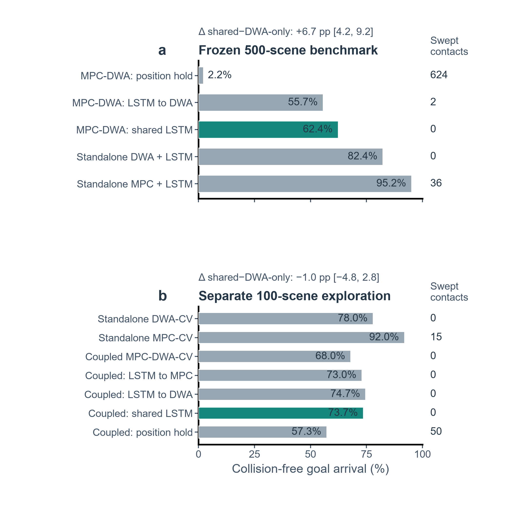
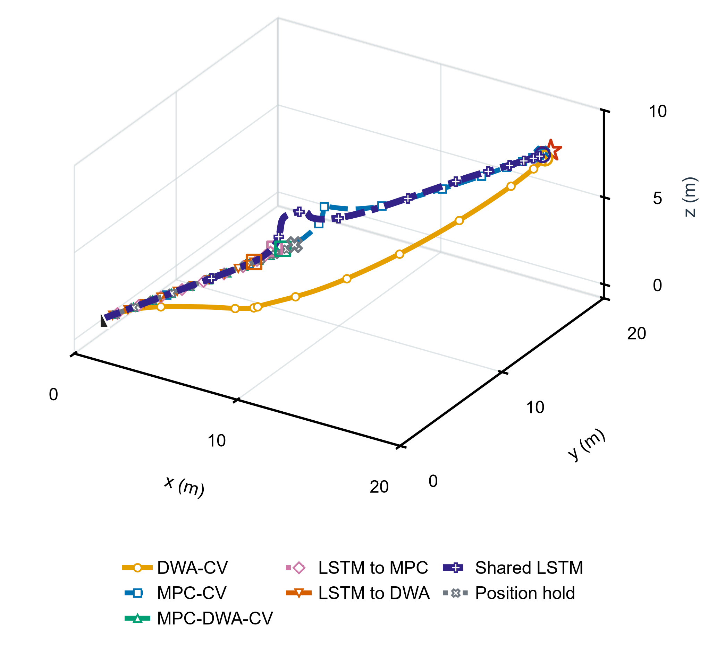

# 论文中英对照全文
**底本说明：** 本稿逐段对应当前 02_source/main.tex。主文报告两套分开分析的仿真证据：一是冻结方案下 500 场景五控制器基准中的共享预测对比（两组各 1,500 次），这 3,000 条记录已包含在 7,500 次基准运行中，不另计样本；二是另一个 100 场景七方法探索性评估（每种方法 300 次，共 2,100 次）。完整五控制器结果和 CV/Kalman 对比均保留在补充材料。4,320 次 Stage-1 记录是独立的开发集权重选择证据，不计入评估结果；Stage-2 尚未完成，也没有真实飞行验证。

## 阅读索引

- Title, abstract, and keywords / 题名、摘要与关键词
- I. Introduction / 引言
- II. Problem Formulation / 问题建模
- III. Planning Method / 规划方法
  - Core equations / 核心公式
  - How the shared forecast is used / 共享预测的使用方式
  - Main-text pseudocode / 正文伪代码
- IV. Simulation and Results / 仿真与结果
  - Protocol-separated outcome comparison and seven-method routes / 分方案结果对比与七方法路径
- V. Discussion / 讨论
- VI. Conclusion / 结论
- Supplementary Methods clarification / 补充方法说明
  - Supplementary Figure S3: retained CV/Kalman route comparison / 补充图 S3：保留的 CV/Kalman 路径对比
  - Supplementary Figure S4: historical scene 404 route example / 补充图 S4：历史场景 404 路径示例
- References / 参考文献

### 公式索引

- [E001 · Eq. (1)](#E001)：无人机运动模型与带符号表面间隙
- [E002 · Eq. (2)](#E002)：CV 与 LSTM 障碍物位置预测
- [E003 · Eq. (3)](#E003)：MPC 目标函数与耦合约束
- [E004 · Eq. (4)](#E004)：信任评分与自适应采样预算
- [E005 · Eq. (5)](#E005)：DWA 安全筛选、评分与 MPC 控制包络

## 题名与作者

**Source:** 02_source/main.tex, title and author

**Original:** A Shared LSTM Forecast for 3-D UAV Planning with Coupled MPC--DWA in Dynamic Obstacle Fields  
Zhenhui Fu*, Beijing University of Chemical Technology, Beijing 100029, China. *Corresponding author: 2025090094@buct.edu.cn.

**中文:** 动态障碍场中共享 LSTM 预测的三维无人机耦合 MPC–DWA 规划  
作者：Zhenhui Fu*；北京化工大学，中国北京 100029。*通讯作者：2025090094@buct.edu.cn。

## Abstract / 摘要

**Source:** 02_source/main.tex, abstract

**Original:** First, UAVs must avoid moving obstacles in three dimensions even when turns, acceleration and pauses make their motion hard to predict. Second, we couple model predictive control (MPC) and the dynamic window approach (DWA) through one causal long short-term memory (LSTM) forecast: MPC uses it to plan a route, while DWA screens reachable actions and bounds MPC's first command. Then, in a frozen 500-scene comparison with a 1-s DWA screen, shared LSTM reached the goal without collision in 936/1,500 runs (62.4%), versus 836/1,500 (55.7%) when only DWA received LSTM. The paired difference was 6.7 percentage points (95% scene-cluster confidence interval, 4.2--9.2). In a separate 100-scene evaluation with a 3-s screen, sharing reached 73.7%; its contrast with DWA-only LSTM was inconclusive, while standalone MPC-CV had the highest rate, 92.0%. Finally, the simulations identify a protocol-specific benefit of forecast sharing and a protocol-dependent controller ranking; flight validation remains future work.

**中文:** 首先，无人机必须在三维空间躲避运动障碍物，而障碍物的转向、加速和暂停使未来运动难以预测。其次，本方法将模型预测控制（MPC）与动态窗口法（DWA）通过同一条因果长短期记忆网络（LSTM）预测相连：MPC 用预测规划路线，DWA 筛选可达动作并约束 MPC 的首个指令。然后，在冻结方案的 500 场景、DWA 滚动时域为 1 s 的对比中，共享 LSTM 有 936/1,500 次无碰撞到达（62.4%），仅向 DWA 输入 LSTM 的方法为 836/1,500 次（55.7%）；配对差为 6.7 个百分点（按场景聚类的 95% 置信区间：4.2–9.2）。在另一个 DWA 时域为 3 s 的 100 场景评估中，共享方法到达率为 73.7%，与仅向 DWA 输入 LSTM 的差异区间包含零；独立 MPC-CV 的到达率最高，为 92.0%。最后，这些仿真表明共享预测的收益具有方案依赖性，控制器排序也随方案变化；实机飞行验证仍需后续完成。

**Source:** 02_source/main.tex, IEEE keywords

**Original:** UAV, 3D path planning, dynamic obstacles, LSTM, model predictive control, dynamic window approach

**中文:** 无人机；三维路径规划；动态障碍物；长短期记忆网络；模型预测控制；动态窗口法。

## I. Introduction / 引言

**Source:** 02_source/main.tex, Introduction, paragraph 1

**Original:** Unmanned aerial vehicles (UAVs) must avoid obstacles that move during flight. Turns, acceleration and pauses make recent positions unreliable guides to what happens next. Model predictive control (MPC) optimizes a short future route, whereas the dynamic window approach (DWA) selects a feasible next action [1, 2]. Predictive UAV planners already use obstacle-motion forecasts in route optimization [3, 4]; here we test where one causal long short-term memory (LSTM) forecast should enter a coupled MPC--DWA loop. The main comparison tests whether also giving MPC the forecast already used by DWA changes outcomes; CV-only, MPC-only-LSTM, DWA-only-LSTM and standalone arms provide context.

**中文:** 无人机（UAV）必须避开飞行过程中移动的障碍物。障碍物转向、加速或暂停，使近期位置难以可靠地指示其后续运动。模型预测控制（MPC）优化一段短期路线，动态窗口法（DWA）选择飞行器下一步能够执行的动作 [1, 2]。近期无人机规划也已将障碍物运动预测用于路线优化 [3, 4]；本文检验同一条因果长短期记忆网络（LSTM）预测应如何接入耦合 MPC–DWA 闭环。主要对比检验：在 DWA 已使用该预测的基础上，再将它提供给 MPC 是否改变结果；仅使用 CV、仅 MPC 使用 LSTM、仅 DWA 使用 LSTM 及独立方法用于补充对照。

## II. Problem Formulation / 问题建模

**Source:** 02_source/main.tex, Problem Formulation

**Original:** We model the UAV as a collision sphere in a bounded 3-D workspace with a start, goal and moving spherical obstacles. Each obstacle has an observed center, radius and time-varying path; future ground-truth positions are hidden from the planner. At each update, it chooses a dynamically feasible action to reach the goal without intersecting an obstacle along the simulated motion. Figure 1 shows the scene geometry; recorded planner paths are compared separately.

**中文:** 我们将无人机建模为一个碰撞球体，在有界三维工作空间内从起点飞向目标，并避让球形移动障碍物。每个障碍物具有观测到的中心、半径和随时间变化的路径；规划器无法获知其未来真实位置。每次更新时，规划器选择满足动力学可行性的动作，以便到达目标且在仿真运动过程中不与障碍物相交。图 1 展示场景几何；记录到的规划器路径另行比较。

### Figure 1 / 图 1：问题几何示意

**Original caption:** Problem geometry: the quadrotor is centered at the start and moves toward the goal among spherical obstacles following prescribed paths (arrows). The dashed line marks the direct start-to-goal direction; planner trajectories appear in Figure 4.

**中文图注：** 问题几何：四旋翼无人机以起点为中心位置，朝目标移动；球形障碍物沿预设路径运动（箭头所示）。虚线表示起点到目标的直达方向；规划器轨迹见图 4。

## III. Planning Method / 规划方法

**Source:** 02_source/main.tex, Planning Method, introductory paragraph

**Original:** With the scene defined, the planner uses one causal obstacle forecast to align route optimization with near-term action screening.

**中文:** 场景建模后，规划器使用同一条因果障碍物预测，使路线优化与近期动作筛查相衔接。

### Core equations / 核心公式

**Source:** 02_source/main.tex, Core equations, introductory paragraph

**Original:** The following compact relations define the state update, obstacle forecast and quantities used by the planners.

**中文:** 下面用几组紧凑公式定义状态更新、障碍物预测及规划器使用的量。

**Source:** 02_source/main.tex, Eq. (1), eq:model

$$
\begin{aligned}
\mathbf h_t&=[\cos\theta_t\cos\psi_t,\cos\theta_t\sin\psi_t,\sin\theta_t]^{\mathsf T},\\
\mathbf p_{t+1}&=\mathbf p_t+\Delta t\,v_t\mathbf h_t,\\
v_{t+1}&=v_t+\frac{\Delta t}{\tau_v}(v_{c,t}-v_t),\\
\theta_{t+1}&=\theta_t+\Delta t\,\omega_{\theta,t},\quad
\psi_{t+1}=\psi_t+\Delta t\,\omega_{\psi,t},\\
\hat d_{j,k}&=\|\mathbf p_{t+k|t}-\hat{\mathbf o}_{j,t+k|t}\|_2-r_u-r_j.
\end{aligned}
$$

**Source:** 02_source/main.tex, paragraph after Eq. (1)

**Original:** Here $t$ is the current step, $k$ a future step, and $j=1,\ldots,M$ indexes the $M$ obstacles. The unit direction $\mathbf h_t$ follows the UAV's pitch $\theta_t$ and yaw $\psi_t$. The update period is $\Delta t=0.1$ s; $\tau_v$ is the speed-response time; $v_c,\omega_\theta,\omega_\psi$ are commanded speed, pitch rate and yaw rate. In the clearance term, $\mathbf p_{t+k|t}$ and $\hat{\mathbf o}_{j,t+k|t}$ are the predicted UAV position and obstacle centre at step $k$. The UAV and obstacle radii are $r_u$ and $r_j$. Positive $\hat d_{j,k}$ means separation, zero contact, and negative overlap.

**中文:** 这里，$t$ 表示当前步，$k$ 表示未来步，$j=1,\ldots,M$ 为 $M$ 个障碍物的索引。单位方向 $\mathbf h_t$ 由无人机俯仰角 $\theta_t$ 和偏航角 $\psi_t$ 决定。更新间隔 $\Delta t=0.1$ s；$\tau_v$ 为速度响应时间；$v_c,\omega_\theta,\omega_\psi$ 分别是速度、俯仰角速度和偏航角速度指令。在间隙计算中，$\mathbf p_{t+k|t}$ 与 $\hat{\mathbf o}_{j,t+k|t}$ 分别表示第 $k$ 步预测的无人机位置和障碍物中心。$r_u$ 和 $r_j$ 分别为无人机与障碍物半径。$\hat d_{j,k}$ 为带符号表面间隙：正值表示分离，零表示接触，负值表示重叠。

**Source:** 02_source/main.tex, paragraph introducing CV and LSTM forecasts

**Original:** At each update, the causal LSTM [5] maps ten obstacle observations to thirty 3-D offsets from the latest observed centre:

**中文:** 每次更新时，因果 LSTM [5] 将障碍物连续十次观测映射为相对于最新观测中心的 30 个三维偏移量：

**Source:** 02_source/main.tex, Eq. (2), eq:forecast

$$
\begin{aligned}
\mathbf q_{j,s}&=[\mathbf o_{j,s}^{\mathsf T},\mathbf v_{j,s}^{\mathsf T},\cos\chi_{j,s},\sin\chi_{j,s}]^{\mathsf T},\\
\hat{\mathbf o}^{\rm LSTM}_{j,t+k|t}&=\mathbf o^{\rm obs}_{j,t}+[f_{\Theta}(\mathbf q_{j,t-9:t})]_k.
\end{aligned}
$$

**Source:** 02_source/main.tex, paragraph after Eq. (2)

**Original:** Here $s$ indexes history and $k=1,\ldots,30$ indexes forecast steps. The position $\mathbf o$ and velocity $\mathbf v$ in $\mathbf q$ are observed obstacle inputs, followed by sine and cosine of heading $\chi$; thus $\mathbf q$ has eight features. The trained network $f_\Theta$ uses learned weights $\Theta$ and outputs a 3-D offset for each future step; $[\cdot]_k$ selects offset $k$. Ten observations span 0.9 s and the 30 outputs span 3 s. The forecast is causal and each offset is anchored to the latest observed centre, not cumulatively summed. At startup, the earliest state fills missing history. CV baselines extrapolate from the latest two observed positions (zero initial velocity when only one is available); position hold repeats the latest centre. Training details are in Supplementary Methods.

**中文:** 这里，$s$ 表示历史时刻索引，$k=1,\ldots,30$ 表示预测步。$\mathbf q$ 中的 $\mathbf o$ 和 $\mathbf v$ 是观测到的障碍物位置和速度，后两项是障碍物航向角 $\chi$ 的余弦与正弦，因此共有八个输入特征。$f_\Theta$ 是经过训练的网络，$\Theta$ 表示其学习得到的权重；网络为每个未来步输出一个三维偏移量，$[\cdot]_k$ 选取第 $k$ 个偏移。十次观测覆盖 0.9 s，30 个输出覆盖 3 s。预测仅依赖当前及过去信息，每个偏移均锚定在最新观测中心，而非逐步累加。启动时以最早可用状态填充历史。CV 基线根据最近两个观测位置外推（仅有一次观测时初速度置零）；位置保持基线则重复使用最新中心。训练细节见补充方法。

**Source:** 02_source/main.tex, paragraph introducing the MPC objective and coupling

**Original:** MPC uses the forecast over its 30-step horizon to minimize goal error, control effort and changes, route deviation, and obstacle-clearance penalties:

**中文:** MPC 在 30 步预测时域内使用障碍物预测，并综合最小化目标误差、控制量及其变化、路线偏离和障碍物间隙惩罚：

**Source:** 02_source/main.tex, Eq. (3), eq:mpc

$$
\begin{aligned}
\min_{\mathbf u_{1:30}}J_{\rm MPC}={}&
\sum_{k=0}^{29}w_p\|\mathbf p_{t+k|t}-\mathbf g\|_2^2\\
&+w_f\|\mathbf p_{t+30|t}-\mathbf g\|_2^2+w_rJ_r\\
&+\sum_{k=1}^{30}w_u\|\mathbf u_k\|_2^2
+w_{\Delta u}\sum_{k=2}^{30}\|\mathbf u_k-\mathbf u_{k-1}\|_2^2\\
&+\sum_{k=1}^{30}\sum_j
\left(w_o[-\hat d_{j,k}]_+^2+w_s[d_{\rm soft}-\hat d_{j,k}]_+^2\right),\\
\text{s.t. }&\mathbf x_{t+k|t}=f(\mathbf x_{t+k-1|t},\mathbf u_k),\quad
\mathbf u_1\in\mathcal U_t\ \text{if }\mathcal A_t\ne\varnothing.
\end{aligned}
$$

**Source:** 02_source/main.tex, paragraph after Eq. (3)

**Original:** Here $\mathbf u_{1:30}$ denotes the sequence of 30 future commands; $\mathbf x=[\mathbf p^{\mathsf T},\theta,\psi,v]^{\mathsf T}$ is the position--pitch--yaw--speed state; $\mathbf u_k=[v_{c,k},\omega_{\theta,k},\omega_{\psi,k}]^{\mathsf T}$ is command $k$, $\mathbf g$ is the goal, and $f$ is the discrete state transition in Eq. (1). $J_r$ sums squared cross-track distances from the direct start-to-goal line. The weights $w_p,w_f,w_r,w_u,w_{\Delta u},w_o,w_s$ penalize stage goal error, terminal error, route deviation, control effort, command changes, overlap and clearance below $d_{\rm soft}=0.35$ m. The positive-part function is $[x]_+=\max(0,x)$. Physical command and rate limits remain active; because native command values are squared without cross-channel normalization, the effort term is heuristic rather than physical energy. Full geometric definitions, weights and limits are in Supplementary Methods S1.1. Clearance penalties are soft and do not certify safety.

**中文:** 这里，$\mathbf u_{1:30}$ 表示未来 30 步控制指令组成的序列；$\mathbf x=[\mathbf p^{\mathsf T},\theta,\psi,v]^{\mathsf T}$ 表示位置、俯仰角、偏航角和速度状态；$\mathbf u_k=[v_{c,k},\omega_{\theta,k},\omega_{\psi,k}]^{\mathsf T}$ 是第 $k$ 步控制指令，$\mathbf g$ 是目标点，$f$ 表示式（1）中的离散状态转移函数。$J_r$ 汇总预测路线相对起点—目标直线的平方横向距离。权重 $w_p,w_f,w_r,w_u,w_{\Delta u},w_o,w_s$ 依次惩罚阶段目标误差、终端误差、路线偏差、控制量、控制变化、障碍物重叠，以及小于 $d_{\rm soft}=0.35$ m 的间隙。正部函数为 $[x]_+=\max(0,x)$。物理控制量与变化率限值始终生效；实现中不同单位的控制量直接平方且未作通道归一化，因此控制代价是启发式量，而非物理能量。几何定义、权重和限值见补充方法 S1.1。间隙项是软惩罚，本身不构成安全保证。

**Source:** 02_source/main.tex, trust-score introduction

**Original:** Trust allocates DWA samples between guided and exploratory actions using safety, goal progress, agreement with the previous MPC guide, and control smoothness:

**中文:** 信任评分依据预测安全性、目标推进、与上一轮 MPC 引导路线的一致程度和控制平滑性，在 DWA 引导采样与探索采样之间分配计算资源：

**Source:** 02_source/main.tex, Eq. (4), eq:trust

$$
\begin{aligned}
\tau&=\sigma_s\tau_{\rm sa}+\sigma_g\tau_g+\sigma_t\tau_{\rm ref}+\sigma_m\tau_{\rm sm},\\
\tau_{\rm ref}&=\exp(-\alpha_T\Delta_p),\\
B&=\operatorname{round}[300(1+\alpha e^{-\beta\tau})],\\
B_g&=\operatorname{round}(B\tau),\quad B_e=B-B_g.
\end{aligned}
$$

**Source:** 02_source/main.tex, paragraph after Eq. (4)

**Original:** The scores $\tau_{\rm sa},\tau_g,\tau_{\rm ref},\tau_{\rm sm}$ measure safety, goal progress, agreement with the previous MPC guide and control smoothness; their nonnegative weights $\sigma_s,\sigma_g,\sigma_t,\sigma_m$ sum to one. The mismatch $\Delta_p$ is the distance from the current UAV position to the guide's first predicted position, and $\alpha_T=3~\mathrm{m}^{-1}$. The 300-based budget $B$ splits into guided samples $B_g$ and exploratory samples $B_e$; higher trust raises the guided share while reducing the total budget. The weights were selected in a separate 4,320-episode Stage-1 development sweep (six vectors, five integrated arms, 48 scenes and three seeds). The selected vector $[0.15,0.15,0.15,0.55]$ maximized the five-arm equal-weight mean collision-free goal-arrival rate (0.8042) in that development set, not a held-out test. The historical 1-s benchmark retained inherited weights $[0.35,0.30,0.15,0.20]$, untuned on its 500 scenes. Budget settings $\alpha=1$, $\beta=3$ and reference-decay setting $\alpha_T=3~\mathrm{m}^{-1}$ are fixed implementation values; planned Stage-2 calibration was incomplete. Full score definitions and parameters are in Supplementary Methods S1.2.

**中文:** 四项评分 $\tau_{\rm sa},\tau_g,\tau_{\rm ref},\tau_{\rm sm}$ 分别衡量安全性、目标推进、与上一轮 MPC 引导路线的一致性及控制平滑度；非负权重 $\sigma_s,\sigma_g,\sigma_t,\sigma_m$ 之和为 1。$\Delta_p$ 是当前无人机位置与引导路线首个预测位置之间的距离，$\alpha_T=3~\mathrm{m}^{-1}$。以 300 为基数的总预算 $B$ 分为引导样本 $B_g$ 和探索样本 $B_e$；信任度越高，引导样本比例越大，但总预算越小。权重由单独的 4,320 次阶段 1 开发实验选出（六组权重、五种集成分支、48 个场景、每场景 3 个种子）。向量 $[0.15,0.15,0.15,0.55]$ 在该开发集上使五分支等权平均无碰撞到达率最高（0.8042），但这不是留出测试。历史 1 s 基准保留继承权重 $[0.35,0.30,0.15,0.20]$，未在其 500 个场景上调参。预算参数 $\alpha=1$、$\beta=3$ 和参考衰减参数 $\alpha_T=3~\mathrm{m}^{-1}$ 均为固定实现设置；计划中的阶段 2 校准尚未完成。完整评分定义和参数见补充方法 S1.2。

**Source:** 02_source/main.tex, DWA screening and scoring introduction

**Original:** DWA rejects unsafe rollouts, scores the survivors, and uses their control range to bound MPC's first input:

**中文:** DWA 首先剔除不安全的滚动轨迹，再对保留动作评分，并用其控制范围约束 MPC 的首个输入：

**Source:** 02_source/main.tex, Eq. (5), eq:dwa

$$
\begin{aligned}
\mathcal A_t&=\{b\in\mathcal B_t:d_{\min}^{(b)}>0.25~\mathrm m,\ \mathcal C_b=1,\\
&\hspace{1em}(v_{\rm end}^{(b)})^2\leq2a_{\max}d_{\min}^{(b)}\},\quad
b^*=\arg\max_{b\in\mathcal A_t}S_b,\\
u_{i,t}^{-}&=\max\!\left(u_i^{\min},\min_{b\in\mathcal A_t}u_i^{(b)}-\delta\right),\\
u_{i,t}^{+}&=\min\!\left(u_i^{\max},\max_{b\in\mathcal A_t}u_i^{(b)}+\delta\right),\\
\mathcal U_t&=\prod_{i=1}^{3}[u_{i,t}^{-},u_{i,t}^{+}],\quad \delta=0.1.
\end{aligned}
$$

**Source:** 02_source/main.tex, paragraph after Eq. (5)

**Original:** Here $\mathcal B_t$ is the sampled set, and $d_{\min}^{(b)}$ is candidate $b$'s minimum clearance over the active DWA screen and all obstacles. The frozen benchmark screens the first 10 forecast states (1 s); the separate exploratory evaluation screens all 30 (3 s). MPC uses a 30-step (3-s) horizon in both. The indicator $\mathcal C_b=1$ means the rollout remains inside the flight corridor. The terminal speed is $v_{\rm end}^{(b)}$ and available deceleration is $a_{\max}=1.0$ m s$^{-2}$. $S_b$ ranks MPC-endpoint agreement, heading, speed, obstacle clearance and vertical profile. For a nonempty safe set $\mathcal A_t$, its per-coordinate extrema, expanded by $\delta=0.1$ in each control coordinate and clipped to its physical limits $u_i^{\min},u_i^{\max}$, form $\mathcal U_t$; this numerical margin is an implementation heuristic because the controls have different units. The DWA action is executed unless optional lateral recentering is triggered; the adjusted rollout is re-screened, and failure reverts to the original screened action. The envelope constrains only MPC's first command; safety remains with the screened rollout that is executed. If the normal safe set is empty, emergency actions are screened; if none passes, the simulator stops. A continuous piecewise-linear swept-path audit then classifies reported collision-free arrivals between the discrete states used online. Full scores and fallback logic are in Supplementary Methods S1.2--S1.4.

**中文:** 这里，$\mathcal B_t$ 是采样动作集合；$d_{\min}^{(b)}$ 是候选动作 $b$ 在当前 DWA 筛查时域和全部障碍物中的最小间隙。冻结基准筛查前 10 个预测状态（1 s），另一项探索性评估筛查全部 30 个状态（3 s）；两者的 MPC 时域均为 30 步（3 s）。$\mathcal C_b=1$ 表示轨迹未离开飞行走廊。$v_{\rm end}^{(b)}$ 为末端速度，可用减速度 $a_{\max}=1.0$ m s$^{-2}$。评分 $S_b$ 综合 MPC 终点一致性、航向、速度、障碍物间隙和垂直剖面。若安全集 $\mathcal A_t$ 非空，则各控制分量在安全候选中的最小值和最大值经 $\delta=0.1$ 扩展，并裁剪到对应分量的物理限值 $u_i^{\min},u_i^{\max}$，形成 $\mathcal U_t$；由于三个控制分量单位不同，这个数值裕度是实现中的启发式量。若触发可选横向重居中，调整后的轨迹必须重新筛查；未通过时恢复原先筛查通过的动作。该范围只约束 MPC 首个控制指令，实际安全性由最终执行的筛查通过轨迹承担。若普通安全集为空，则筛查应急动作；若均不通过，仿真停止。随后使用连续分段线性的扫掠路径审计，在在线离散状态之间判定所报告的无碰撞到达。完整评分与回退流程见补充方法 S1.2–S1.4。

### How the shared forecast is used / 共享预测的使用方式

**Source:** 02_source/main.tex, How the shared forecast is used

**Original:** Every 0.1 s, the causal LSTM produces one time-aligned 3-s obstacle forecast for both planners. MPC uses all 30 positions in its route cost; DWA screens the first 10 in the frozen benchmark and all 30 in the separate exploratory evaluation. This division is deliberate: MPC plans around predicted future conflicts, while DWA checks whether the next command is reachable and passes local rollout gates. Sharing aligns both checks to the same predicted obstacle motion. Passing DWA controls constrain MPC's first command on re-solve, while the screened DWA action is executed. Because the MPC guide also sets DWA's trust-based sampling budget, changing the forecast supplied to MPC can change both the route cost and DWA's guided/exploratory allocation. The paired contrast therefore estimates the closed-loop effect of enabling MPC's LSTM input, not the isolated effect of the MPC forecast penalty. In the DWA-only arm, MPC instead uses latest-position hold in the historical benchmark and its configured CV input in the 3-s ablation. Figure 2 summarizes the cycle; Supplementary Methods S1.4 gives the full fallback logic.

**中文:** 每 0.1 s，因果 LSTM 为两个规划器生成同一条按时间对齐的 3 s 障碍物预测。MPC 在路径代价中使用全部 30 个位置；冻结基准中的 DWA 筛查前 10 个位置，另一项探索性评估中的 DWA 则筛查全部 30 个位置。这样分工是有意设计的：MPC 根据预测的未来冲突规划路线，DWA 检查下一条指令是否可达并通过局部轨迹筛查；共享预测使两者面对相同的障碍物未来。通过筛查的 DWA 控制范围在 MPC 重求解时约束其首个指令，同时执行筛查通过的 DWA 动作。由于 MPC 引导还决定 DWA 信任度采样预算，将预测输入 MPC 也可能改变 DWA 引导采样与探索采样的分配。因此，配对对比估计的是在该闭环系统中启用 MPC 的 LSTM 输入后的整体效果，而非 MPC 预测代价项的独立作用。DWA-only 组的历史基准中 MPC 使用最新位置保持，3 s 单层消融中的 MPC 则使用其配置的 CV 输入。图 2 概括该循环，完整回退流程见补充方法 S1.4。

### Figure 2 / 图 2：共享预测规划器伪代码

**Original caption:** Numbered modules in one 0.1-s receding-horizon update. One causal LSTM forecast feeds MPC's route guide and DWA's action screen; the MPC guide also informs DWA sampling. The branches show normal safe-action selection, optional re-screened recentering, and emergency screening with stop if no candidate passes.

**中文图注：** 共享预测规划器单次 0.1 s 滚动时域更新的编号模块图。同一条因果 LSTM 预测进入 MPC 路线引导和 DWA 动作筛选，MPC 引导同时用于 DWA 采样。分支展示普通安全动作选择、复筛后的可选重居中，以及无普通候选时的应急筛查；若无候选通过则停止。

#### Algorithm S1 / 算法 S1：共享预测的 MPC–DWA 循环

**中文步骤说明：** 输入为无人机当前状态、障碍物最近 10 次观测和上一轮 MPC 解。每个 0.1 s 周期中，LSTM 根据观测预测未来 30 步障碍物位置，并将同一条带时间索引的预测交给 MPC 与 DWA；MPC 在启动时初始化参考路线，之后滚动上一轮解。随后根据安全、目标进展、路线跟踪和控制平滑度更新信任度，并据此调整 DWA 引导采样与探索采样的分配。DWA 对可达控制动作展开轨迹，在相同的 30 步预测上依次检查间隙、飞行走廊和制动条件，再对保留动作评分。若常规安全候选存在，则选出 DWA 动作及其控制范围；否则筛查紧急动作。若紧急候选为空则停止；有候选时，在重求解前再次筛查选定的紧急动作。随后 MPC 使用同一预测重求解：常规情况下受 DWA 安全动作范围约束，回退情况下仅受物理控制限值约束。最后执行通过检查的 DWA/紧急动作 0.1 s，更新状态和历史并进入下一轮。输出为通过检查的下一动作及更新后的 MPC 参考，或安全停止。

## IV. Simulation and Results / 仿真与结果

**Source:** 02_source/main.tex, frozen five-controller result paragraph

**Original:** Under the frozen 1-s DWA/3-s MPC protocol with inherited weights, 500 scenes and three matched seeds compared shared LSTM with DWA-only LSTM. DWA received LSTM forecasts in both arms; only the shared arm also supplied them to MPC. Safe arrival was 936/1,500 (62.4%) versus 836/1,500 (55.7%), a paired gain of 6.7 percentage points (95% scene-cluster CI, 4.2--9.2). These 3,000 runs are part of the 7,500-run benchmark, not an extra sample. In the same protocol, standalone DWA+LSTM and MPC+LSTM reached 82.4% and 95.2%, respectively, while the latest-position-hold reconstruction reached 2.2%. Forecast sharing improved on DWA-only input in the paired comparison, while the independent controllers recorded higher aggregate rates.

**中文:** 在冻结的 1 s DWA/3 s MPC 方案及继承权重下，我们用 500 个场景、每场景三个匹配种子比较共享 LSTM 与仅 DWA 使用 LSTM 的集成方法。两组 DWA 都接收 LSTM 预测；只有共享组还将预测输入 MPC。共享组无碰撞到达 936/1,500 次（62.4%），仅 DWA 使用 LSTM 组为 836/1,500 次（55.7%），配对差为 6.7 个百分点（按场景聚类的 95% CI：4.2–9.2）。这 3,000 次运行已包含在五控制器基准的 7,500 次记录中，并非新增样本。同一方案下，独立 DWA+LSTM 和独立 MPC+LSTM 到达率分别为 82.4% 和 95.2%，最新位置保持重构为 2.2%。因此，共享预测在配对比较中优于仅向 DWA 输入预测，而独立控制器的总体到达率更高。

**Source:** 02_source/main.tex, separate seven-method result paragraph

**Original:** The separate exploratory evaluation comprised 2,100 episodes: seven arms, 100 distinct scenes and three matched seeds per scene. It used 0.1-s updates, 3-s MPC/DWA horizons and a 650-step limit. The arms were standalone DWA-CV and MPC-CV, coupled MPC--DWA-CV, LSTM to MPC only, LSTM to DWA only, shared LSTM and latest-position hold. Arrival required goal tolerance without swept-path contact; seeds were averaged within scene, and 20,000 scene-cluster bootstrap resamples formed simultaneous max-|t| intervals for six shared-versus-comparator contrasts. Shared LSTM reached in 221/300 runs (73.7%), compared with 276/300 (92.0%) for standalone MPC-CV, the highest rate; MPC-CV also had 15 swept-contact runs. Its difference from DWA-only LSTM was inconclusive; it exceeded position hold by 16.3 points (95% CI, 5.1--27.6) but was 18.3 points below MPC-CV (95% CI, -29.6 to -7.0). Controller rankings therefore remained protocol-dependent.

**中文:** 另一个探索性评估共 2,100 次运行：七种方法、100 个独立场景，每场景三个匹配种子。仿真每 0.1 s 更新，MPC 与 DWA 时域均为 3 s，最多运行 650 步。七种方法为独立 DWA-CV、独立 MPC-CV、耦合 MPC–DWA-CV、仅 MPC 使用 LSTM、仅 DWA 使用 LSTM、共享 LSTM 和最新位置保持。安全到达要求进入目标容差且扫掠路径无接触；先在场景内平均种子结果，再通过 20,000 次场景聚类 bootstrap 为六项共享方法对比构造同时 max-|t| 区间。共享 LSTM 到达 221/300 次（73.7%）；独立 MPC-CV 为 276/300 次（92.0%），是该评估中的最高率，此外还有 15 次扫掠接触。共享方法与仅 DWA 使用 LSTM 的差异尚不确定；它比位置保持高 16.3 个百分点（95% CI：5.1–27.6），但比 MPC-CV 低 18.3 个百分点（95% CI：−29.6 至 −7.0）。因此，控制器排序随实验方案而变化。

### Figure 3 / 图 3：两套方案的安全到达率

**Original caption:** Collision-free goal-arrival rates in two separate protocols. (a) Frozen five-controller benchmark: 500 scenes, three matched seeds, $n=1{,}500$ runs per method and a 1-s DWA screen. (b) Separate seven-method exploration: 100 scenes, three matched seeds, $n=300$ runs per method and a 3-s screen. Bars are point estimates; the paired shared-minus-DWA-only contrast is shown above each panel: +6.7 percentage points (95% scene-cluster CI 4.2--9.2) in (a), and -1.0 points (simultaneous 95% CI -4.8--2.8) in (b). The right column gives swept contacts for each method. Teal highlights shared LSTM; the highest-rate method differs by protocol, and panels are not pooled.

**中文图注：** 两套独立方案中的无碰撞到达率。(a) 冻结的五控制器基准：500 个场景、每场景三个匹配种子、每种方法 $n=1{,}500$ 次运行，DWA 筛查时域为 1 s。(b) 单独的七方法探索评估：100 个场景、每场景三个匹配种子、每种方法 $n=300$ 次运行，DWA 时域为 3 s。柱形表示点估计；上方直接标出共享 LSTM 相对仅 DWA 输入的配对差值：(a) +6.7 个百分点（按场景聚类的 95% CI：4.2–9.2），(b) −1.0 个百分点（同时 95% CI：−4.8–2.8）。右侧逐行列出扫掠接触数；青绿色表示共享 LSTM。两套方案的最高到达率方法不同，结果不跨方案合并排序。

**Source:** 02_source/main.tex, illustrative seven-method route paragraph

**Original:** Figure 4 shows one matched case (scene 72, seed 2): shared LSTM and DWA-CV arrived without swept contact; aggregate comparisons use all scenes.

**中文:** 图 4 展示场景 72、种子 2 的一个匹配示例：共享 LSTM 与 DWA-CV 无扫掠接触地到达目标；总体比较使用全部场景。

### Figure 4 / 图 4：七方法匹配路线示例

**Original caption:** Seven recorded paths in one matched case (scene 72, seed 2). Shared LSTM and DWA-CV arrived without swept contact; MPC-CV reached goal tolerance but had swept contact; the other methods stopped or contacted earlier. Lines connect saved states and end at recorded terminal points. Open circles indicate collision-free arrival, crosses swept contact, and squares other non-arrival; markers denote terminal outcome rather than contact location. This descriptive example complements the aggregate rates in Figure 3b.

**中文图注：** 场景 72、种子 2 中一个匹配示例的七条记录轨迹。共享 LSTM 与 DWA-CV 无扫掠接触地到达目标；MPC-CV 到达目标容差范围但发生扫掠接触；其余方法提前停止或发生接触。线段连接已保存状态，并止于记录的终止点。空心圆表示无碰撞到达，叉号表示扫掠接触，方形表示其他未到达结果；终点标记表示运行结果而非接触位置。该描述性示例与图 3b 的总体到达率相互补充。

### Supplementary Table S12 / 补充表 S12：七方法探索性结果

**Original caption:** Outcome summary for the exploratory simulation (300 episodes per arm). Safe arrival requires reaching the goal without swept-path contact; complete paired intervals are reported in the Supplementary Methods.

**中文表注：** 探索性仿真结果汇总，每种方法 300 次运行。安全到达要求进入目标容差且扫掠路径无接触；完整配对区间见补充方法。

| Controller / 控制器 | Safe-goal rate (%) / 安全到达率（%） | Swept contacts / 扫掠接触 |
|---|---:|---:|
| Standalone DWA-CV / 独立 DWA-CV | 78.0 | 0 |
| Standalone MPC-CV / 独立 MPC-CV | 92.0 | 15 |
| Coupled MPC–DWA-CV / 耦合 MPC–DWA-CV | 68.0 | 0 |
| MPC–DWA (LSTM to MPC only) / MPC–DWA（仅 MPC 使用 LSTM） | 73.0 | 0 |
| MPC–DWA (LSTM to DWA only) / MPC–DWA（仅 DWA 使用 LSTM） | 74.7 | 0 |
| MPC–DWA (shared LSTM) / MPC–DWA（共享 LSTM） | **73.7** | **0** |
| MPC–DWA (latest-position hold) / MPC–DWA（最新位置保持） | 57.3 | 50 |

### Historical five-controller comparison / 历史五控制器对比

**Source:** 03_supplementary/supplementary_methods.tex, S4.2–S4.3

**Original:** The historical five-controller study used 500 scenes with three matched seeds per scene (1,500 episodes per arm), a 1-s DWA rollout and a 30-step MPC horizon. Shared LSTM reached the goal without contact in 936/1,500 episodes (62.4%), compared with 33/1,500 (2.2%) for latest-position hold and 836/1,500 (55.7%) for LSTM-to-DWA-only integration. The paired differences were +60.2 percentage points (95% scene-cluster CI, +56.2 to +64.2) and +6.7 points (+4.2 to +9.2), respectively. Standalone DWA+LSTM and MPC+LSTM reached in 1,236/1,500 (82.4%) and 1,428/1,500 (95.2%). Shared integration was lower than these arms by 20.0 points (95% CI, -24.8 to -15.1) and 32.8 points (-37.1 to -28.5). This historical 1-s study is separate from the current seven-method, 3-s-horizon evaluation.

**中文:** 历史五控制器研究在 500 个场景、每场景三个匹配种子上进行测试（每种方法 1,500 次），DWA 滚动时域为 1 s，MPC 时域为 30 步。共享 LSTM 在 1,500 次运行中有 936 次无接触到达目标（62.4%）；最新位置保持组为 33/1,500 次（2.2%），仅向 DWA 输入 LSTM 的集成组为 836/1,500 次（55.7%）。相应配对差异为 +60.2 个百分点（按场景聚类的 95% CI：+56.2 至 +64.2）和 +6.7 个百分点（+4.2 至 +9.2）。独立 DWA+LSTM 和 MPC+LSTM 分别有 1,236/1,500 次（82.4%）和 1,428/1,500 次（95.2%）到达。共享集成方法分别低 20.0 个百分点（95% CI：−24.8 至 −15.1）和 32.8 个百分点（−37.1 至 −28.5）。这项历史 1 s 研究与当前七方法、3 s 时域评估相互独立。

### Historical Table / 历史表：五控制器研究结果

**Original caption:** Retained results from the historical five-controller study (500 scenes, three matched seeds and 1,500 runs per method; 1-s DWA screening). The latest-position-hold MPC--DWA is a project-local architectural comparator, not a direct rerun.

**中文表注：** 保留的历史五控制器研究结果（500 个场景、每场景三个匹配种子，每种方法 1,500 次；DWA 筛查时域为 1 s）。最新位置保持 MPC–DWA 是项目内构建的架构对照，不是对某项实现的直接复跑。

| Controller / 控制器 | Goal without collision / 无碰撞到达目标 | Swept collision runs / 扫掠碰撞运行次数 |
|---|---:|---:|
| MPC–DWA reconstruction (position hold) / MPC–DWA 重构（位置保持） | 33/1,500 (2.2%) | 624 (41.6%) |
| Integrated MPC–DWA (LSTM to DWA only) / 集成 MPC–DWA（仅 DWA 使用 LSTM） | 836/1,500 (55.7%) | 2 (0.13%) |
| Integrated MPC–DWA (shared LSTM) / 集成 MPC–DWA（共享 LSTM） | **936/1,500 (62.4%)** | **0 (0%)** |
| Standalone DWA + LSTM / 独立 DWA + LSTM | 1,236/1,500 (82.4%) | 0 (0%) |
| Standalone MPC + LSTM / 独立 MPC + LSTM | 1,428/1,500 (95.2%) | 36 (2.4%) |

## V. Discussion / 讨论

**Source:** 02_source/main.tex, Discussion, paragraph 1

**Original:** Forecast sharing raised safe arrival in the frozen 1-s comparison, whereas the 3-s exploration produced an inconclusive shared-versus-DWA-only contrast and ranked standalone MPC-CV highest. The protocols also differed in scene banks, trust weights and horizons, so their ranking change motivates a controlled sensitivity study rather than a pooled estimate. LSTM used simulator-recorded obstacle velocity and heading, whereas CV estimated velocity from positions; the comparisons therefore evaluate complete configured prediction pipelines. Prescribed obstacle tracks, point forecasts and simulation-only evaluation define the present scope, with uncertainty-aware prediction and flight tests as the next validation steps.

**中文:** 在冻结的 1 s 对比中，共享预测提高了安全到达率；在 3 s 探索中，共享方法与仅 DWA 使用 LSTM 的差异区间包含零，独立 MPC-CV 的到达率最高。两套方案的场景库、信任权重和时域也不同，因此排序变化更适合通过受控敏感性实验研究，而不宜合并估计。LSTM 使用模拟器记录的障碍物速度和航向，CV 则根据位置估计速度，因此比较的是完整配置的预测流程。预设障碍物轨迹、点预测和纯仿真评估界定了本文范围；下一步将研究不确定性感知预测并开展实机飞行验证。

## VI. Conclusion / 结论

**Source:** 02_source/main.tex, Conclusion

**Original:** In simulation, shared LSTM increased collision-free arrival by 6.7 percentage points over DWA-only input in the frozen 500-scene, 1-s DWA comparison. In the separate 3-s evaluation, standalone MPC-CV had the highest rate, and the shared-versus-DWA-only contrast was inconclusive.

**中文:** 在仿真中，冻结的 500 场景、1 s DWA 对比显示，共享 LSTM 相较仅向 DWA 输入预测，无碰撞到达率提高了 6.7 个百分点。在单独的 3 s 评估中，独立 MPC-CV 的到达率最高；共享方法与仅 DWA 使用 LSTM 的差异尚不确定。

## Supplementary Methods clarification / 补充方法说明

**Source:** ../03_supplementary/supplementary_methods.tex, S1.2–S1.3

**Original:** Smoothness uses consecutive MPC control increments $\Delta\mathbf u_k=\mathbf u_k-\mathbf u_{k-1}$. The score is $\tau_{\rm sm}=\operatorname{clip}_{[0,1]}\!\left[1-\frac{1}{3(N-1)}\sum_{i=1}^{3}\sum_{k=2}^{N}\frac{|\Delta u_{k,i}|}{a_{u,i}\Delta t}\right]$.

Here $i$ indexes desired speed, pitch rate and yaw rate; $N=30$, $\Delta t=0.1$ s, and $\mathbf a_u=[1~\mathrm{m\,s^{-2}},\ 0.5~\mathrm{rad\,s^{-2}},\ 0.5~\mathrm{rad\,s^{-2}}]^{\mathsf T}$. At startup, the initial MPC solution initializes the aligned reference and control sequence; thereafter, the preceding solution is shifted before the trust scores are computed. Guided controls are sampled within $r_{\rm Guide}=0.35$ per control component of the clipped MPC command, then clipped to the dynamic window. The logistic map is $q=[1+\exp(-8(\tau-0.5))]^{-1}$. The half-width 0.35, slope 8, midpoint 0.5 and additive vertical-score coefficient $w_z=0.25$ are fixed implementation heuristics, held constant in every integrated arm that uses them and not selected using held-out outcomes. The half-width uses native control units ($\mathrm{m\,s^{-1}}$ for speed and $\mathrm{rad\,s^{-1}}$ for pitch and yaw rates); slope and midpoint are dimensionless. The $w_z$ term is added after the four normalized DWA weights and is not renormalized with them.

**中文:** 平滑度分量使用相邻 MPC 控制量的增量 $\Delta\mathbf u_k=\mathbf u_k-\mathbf u_{k-1}$。其评分定义为 $\tau_{\rm sm}=\operatorname{clip}_{[0,1]}\!\left[1-\frac{1}{3(N-1)}\sum_{i=1}^{3}\sum_{k=2}^{N}\frac{|\Delta u_{k,i}|}{a_{u,i}\Delta t}\right]$。其中，$i$ 依次表示期望速度、俯仰角速度和偏航角速度；$N=30$，$\Delta t=0.1$ s，且 $\mathbf a_u=[1~\mathrm{m\,s^{-2}},\ 0.5~\mathrm{rad\,s^{-2}},\ 0.5~\mathrm{rad\,s^{-2}}]^{\mathsf T}$。启动时，以初始 MPC 解初始化对齐后的参考路线与控制序列；此后在计算信任评分前，对上一周期解进行时移。引导控制在裁剪后的 MPC 指令周围按每个控制分量的 $r_{\rm Guide}=0.35$ 半宽采样，随后裁剪到动态窗口内。逻辑映射为 $q=[1+\exp(-8(\tau-0.5))]^{-1}$。半宽 0.35、斜率 8、中点 0.5 和附加垂直评分系数 $w_z=0.25$ 均为固定实现启发式参数；所有使用这些参数的集成分支均保持不变，且未依据留出结果选择。半宽采用各控制量的原生单位（速度为 $\mathrm{m\,s^{-1}}$，俯仰和偏航角速度为 $\mathrm{rad\,s^{-1}}$）；斜率和中点无量纲。$w_z$ 项在四个归一化 DWA 权重之后加入，且不与它们一起重新归一化。

**Source:** ../scripts/run_v12a_pooled_weight_development.m:123,164; ../04_review/v12a_stage1_recovery_audit_20261014.md:5,9,13

**Original:** The Stage-1 trust-weight calibration evaluated six candidate vectors across five trust-using integrated MPC--DWA branches, 48 development scenes and three matched seeds ($6\times5\times48\times3=4{,}320$ simulation episodes). The selected vector $[0.15,0.15,0.15,0.55]$ had an equal-arm macro-average collision-free arrival rate of 0.8042. Development rates were 0.8958 for shared LSTM, 0.7431 for CV-coupled MPC--DWA, 0.8194 for LSTM-to-MPC-only, 0.8958 for LSTM-to-DWA-only and 0.6667 for latest-position hold. These are selection-set descriptions, not held-out comparisons. The earlier 864-episode six-setting comparison used a different protocol and was not reused; a separate recovery audit validated all 4,320 Stage-1 episode records without creating new simulations.

**中文:** 阶段 1 信任权重校准在五种使用信任评分的集成 MPC--DWA 分支、48 个开发场景和每场景 3 个匹配种子上评估六个候选向量（$6\times5\times48\times3=4{,}320$ 次仿真）。选出的向量为 $[0.15,0.15,0.15,0.55]$，其五分支等权宏平均无碰撞到达率为 0.8042。开发率分别为：共享 LSTM 0.8958、CV 耦合 MPC--DWA 0.7431、仅 MPC 使用 LSTM 0.8194、仅 DWA 使用 LSTM 0.8958、最新位置保持 0.6667。这些是用于选参的开发集描述值，不是留出对比结果。此前 864 次六设置实验采用不同协议，未用于本次选择；单独的恢复审计对全部 4,320 条记录进行了校验，没有新增仿真。

### Historical route illustrations / 历史路径示例

### Supplementary Figure S3 / 补图 S3：保留的 CV/Kalman 历史路径

**Source:** 03_supplementary/supplementary_methods.tex, Fig. historical-scene2

**Original caption:** Historical four-method 3-D route example from scene 2 and DWA sampling seed 1. Panels (a)--(d) show CV, Kalman, DWA-only LSTM and shared LSTM under the same prescribed obstacle tracks. The green triangle marks the start, the red star the goal, and the open circle CV's recorded early-stop endpoint. In this example, CV stopped before the goal; the other three methods reached the goal, and all four routes were collision-free under the swept-path test. Each route contains only its saved states through the recorded terminal point; none is extended or interpolated. Obstacle tracks show scene context and are not time-aligned with route durations. This single historical example illustrates route geometry, not aggregate performance, and is reported separately from the historical five-controller benchmark and current seven-method evaluation.

**中文图注：** 历史四方法三维路径示例，取自场景 2、DWA 采样种子 1。(a)–(d) 分别为 CV、Kalman、仅 DWA 使用 LSTM 和共享 LSTM，使用相同的预设障碍物轨迹。绿色三角表示起点，红色星形表示目标点，空心圆表示 CV 记录的提前停止位置。在该例中，CV 未到达目标；其余三种方法到达目标，且四条轨迹均未发生扫掠碰撞。每条路线仅包含已记录状态，并截止于实际终止点，不外延或插值。障碍物轨迹仅作为场景背景，未与各方法的飞行时长进行时间对齐。该单个历史示例展示路径形状，不代表总体性能；其结果与历史五控制器基准及当前七方法评估分开报告。

### Supplementary Figure S4 / 补图 S4：历史场景 404 路径

**Source:** 03_supplementary/supplementary_methods.tex, S7, Fig. primaryroutes

**Original caption:** Historical five-controller 3-D routes from scene 404, seed 2 in the 1-s DWA-screening study. The recorded paths end at their logged terminal states: latest-position-hold MPC--DWA (collision, step 224); standalone DWA + LSTM (stopped, step 20); standalone MPC + LSTM (collision, step 262); integrated MPC--DWA with LSTM to DWA only (stopped, step 220); and integrated MPC--DWA with shared LSTM (collision-free arrival, step 253). Only the shared controller arrived in this illustrative case; aggregate historical outcomes are in Table T002 and Supplementary Methods S4.3. Dashed lines show saved obstacle tracks through step 262. Circles mark arrivals, squares mark non-collision stops, and X marks a run with swept contact, not necessarily at the terminal marker.

**中文图注：** 1 s DWA 筛查历史研究中，场景 404、种子 2 的五条控制器三维路径。所有记录路径均截止于日志记录的终止状态：最新位置保持 MPC–DWA（第 224 步碰撞）；独立 DWA+LSTM（第 20 步停止）；独立 MPC+LSTM（第 262 步碰撞）；仅向 DWA 输入 LSTM 的集成 MPC–DWA（第 220 步停止）；以及共享 LSTM 的集成 MPC–DWA（第 253 步无碰撞到达）。在这个示例中只有共享控制器到达目标；历史总体结果见表 T002 和补充方法 S4.3。虚线表示保存至第 262 步的障碍物轨迹。圆形表示到达，方形表示无碰撞停止，X 表示运行中发生过扫掠接触，接触位置不一定在终点标记处。

### Supplementary Figure S5 / 补图 S5：七方法较长记录轨迹对比

**Original caption:** Seven-method simulated trajectories from scene 72, seed 2. (a) 3-D perspective; (b) XY plan; (c) XZ elevation; (d) YZ elevation. All six comparator paths span at least 5 s. Shared LSTM and standalone DWA achieved collision-free goal arrival; standalone MPC reached goal tolerance after swept contact; position-hold MPC--DWA collided before arrival; the other three coupled variants stopped without contact. Each route contains only saved positions through its logged terminal state. Color, line style and sparse markers at recorded states identify the method; terminal circles, squares and crosses mark safe arrival, no-contact non-arrival and a run with swept contact, respectively (the cross is not the collision location). This matched case illustrates route geometry; aggregate comparisons use the complete evaluation.

**中文图注：** 场景 72、种子 2 的七方法仿真轨迹。(a) 三维透视图；(b) XY 平面投影；(c) XZ 高度投影；(d) YZ 高度投影。六条比较方法轨迹均至少记录 5 s。共享 LSTM 与独立 DWA 无碰撞到达；独立 MPC 虽进入目标容差，但发生扫掠接触；最新位置保持 MPC–DWA 在到达前发生接触；其余三种耦合集成方法无接触停止。每条路线只绘制到日志记录的终止状态，未延长轨迹；颜色、线型和沿路径稀疏标出的真实记录点用于区分方法。终点圆形、方形和叉号分别表示无碰撞到达、未碰撞但未到达、以及运行中发生过扫掠接触（叉号不代表碰撞位置）。该匹配示例用于展示路径形态；总体比较依据完整评估数据。

## References / 参考文献

以下五条文献对应当前英文源文中的引用顺序；出版信息和文献原始标题保留英文。

1.  Mayne, D. Q., Rawlings, J. B., Rao, C. V. & Scokaert, P. O. M. Constrained model predictive control: Stability and optimality. *Automatica* 36(6), 789–814 (2000). https://doi.org/10.1016/S0005-1098(99)00214-9
2.  Fox, D., Burgard, W. & Thrun, S. The dynamic window approach to collision avoidance. *IEEE Robotics & Automation Magazine* 4(1), 23–33 (1997). https://doi.org/10.1109/100.580977
3.  Olcay, E., Meß, H. & Elger, G. Dynamic obstacle avoidance for UAVs using MPC and GP-based motion forecast. In *2024 European Control Conference (ECC)*, 1024–1031 (2024). https://doi.org/10.23919/ECC64448.2024.10591083
4.  Xu, Z., Jin, H., Han, X., Shen, H. & Shimada, K. Intent prediction-driven model predictive control for UAV planning and navigation in dynamic environments. *IEEE Robotics and Automation Letters* 10(5), 4946–4953 (2025). https://doi.org/10.1109/LRA.2025.3555937
5.  Hochreiter, S. & Schmidhuber, J. Long short-term memory. *Neural Computation* 9(8), 1735–1780 (1997). https://doi.org/10.1162/NECO.1997.9.8.1735

## 术语表

| English term | 中文 | 本文中的含义 |
|---|---|---|
| UAV | 无人机 | 本文模拟的飞行器 |
| constant velocity (CV) | 恒定速度 | 根据最近位置差外推障碍物位置的预测基线 |
| latest-position-hold | 最新位置保持 | 在预测时域内固定障碍物最近观测位置的基线 |
| LSTM forecast | LSTM 预测 | 根据因果历史观测预测障碍物未来位置 |
| MPC | 模型预测控制 | 优化多步控制路线并在每次更新时重规划 |
| DWA | 动态窗口法 | 筛选当前动力学可达动作并选择要执行的动作 |
| shared forecast | 共享预测 | 同一 LSTM 预测同时供 MPC 与 DWA 使用 |
| signed surface clearance | 带符号表面间隙 | 两个物体中心距离减去两者半径；正值分离、负值重叠 |
| collision-free arrival | 无碰撞到达目标 | 到达目标容差范围且连续扫掠路径无碰撞 |
| scene-cluster bootstrap | 按场景聚类的自助法 | 以场景为聚类单位进行重抽样的比较方法 |
| componentwise control bounds | 分量级控制边界 | 对速度、俯仰角速度和偏航角速度分别施加的上下界 |

## 阅读提示

当前主文报告的是 100 个场景、三个匹配种子、每方法 300 次的七方法探索性仿真。共享 LSTM 相对最新位置保持重构的安全到达率高 16.3 个百分点，但独立 MPC-CV 的安全到达率更高，且优越性判定门槛未通过。500 场景五控制器基准和 CV/Kalman 路径图作为历史补充证据保留；它们与当前 3 s 评估分开。所有结论均来自仿真，不代表真实飞行表现。

